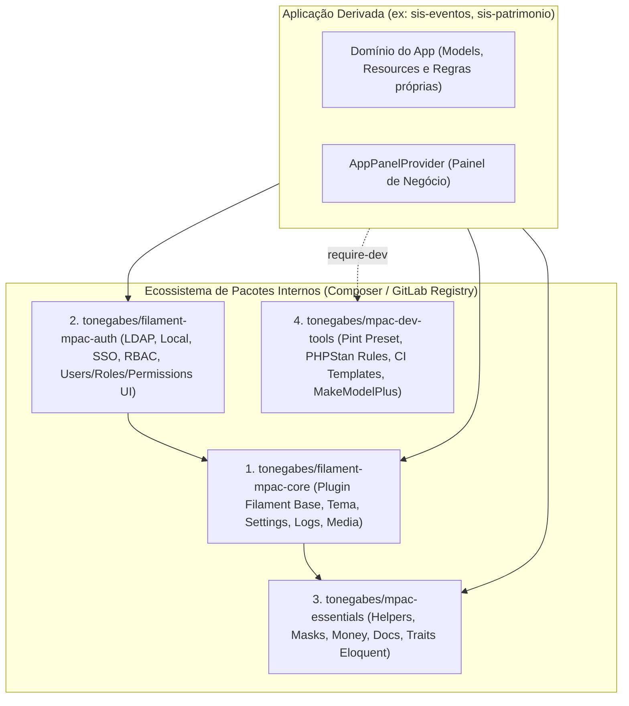

# Diagnóstico Técnico, Melhorias e Estratégia de Modularização (`filament-mpac`)

Este documento apresenta uma auditoria arquitetural completa do projeto `tonegabes/filament-mpac` com foco em seu papel como **Starter Template Oficial da Organização (MPAC)** e define a estratégia para **desmembramento em pacotes (packages/plugins)**, permitindo que múltiplos projetos (novos e legados) recebam atualizações estruturais via `composer update` sem edição manual de código em cada repositório.

---

## Sumário Executivo

O projeto já possui uma fundação moderna e excelente maturidade técnica:
- **Stack de ponta**: PHP 8.4 (`strict_types=1`), Laravel 13, Filament v5, Livewire v4, Pest v5, Tailwind CSS v4.
- **Qualidade automatizada**: PHPStan nível 8 (`bleedingEdge`), Laravel Pint (PSR-12 customizado), testes de arquitetura e cobertura com Pest, CI/CD em GitLab e containerização multi-stage com FrankenPHP + Caddy.
- **Ecossistema próprio iniciado**: Já consome `tonegabes/mpac-essentials`, `tonegabes/filament-phosphor-icons`, `tonegabes/filament-better-options` e `tonegabes/laravel-make-model-plus`.

Contudo, **como um template clonado (`git clone` / `composer create-project`)**, cerca de **80% do código hoje presente em `app/`, `resources/` e `database/` é infraestrutura base da organização** (Autenticação LDAP/Local, Gestão de Usuários/Roles/Permissões, Biblioteca de Mídia, Auditoria, Configurações de Sistema, Tema MPAC e Providers de UI). Quando um novo sistema nasce a partir deste template, esse código passa a pertencer ao repositório do app final — tornando qualquer correção de bug no LDAP, ajuste no tema ou evolução no painel Admin um pesadelo de manutenção manual em dezenas de repositórios.

---

## Parte 1: Falhas e Bugs Identificados no Código Atual

Abaixo estão os problemas concretos encontrados na auditoria do código-fonte atual, classificados por severidade.

### 🔴 Críticos / Altos (Segurança, Autenticação e Bugs Funcionais)

#### 1. Bypass de `is_active` na Autenticação Local e Sessões Ativas
- **Onde**: `app/Filament/Pages/Auth/Login.php` (`attemptLocalAuth` e `attemptDefaultAuth`) e `app/Models/User.php`.
- **Problema**:
  1. No modo **LDAP** (`handleLocalUserRecord`), verifica-se `$user->is_active === false` apenas quando `auth.ldap.requires_local` é `true`. Se `requires_local` for `false` e um usuário já existente no banco local estiver com `is_active = false`, `User::firstOrCreate(['username' => $username], ...)` retorna o usuário inativo existente e permite o login normalmente!
  2. No modo **Local** (`attemptLocalAuth`), `$authGuard->attemptWhen($credentials, ...)` é chamado **sem callback de verificação de `is_active`**. Um usuário com `is_active = false` consegue logar normalmente via credenciais locais.
  3. Se um usuário logado for desativado (`is_active = false`), não há verificação no `User::canAccessPanel()` nem em um middleware para encerrar o acesso imediatamente.
- **Correção**:
  - Em `User::canAccessPanel(?Panel $panel)`: adicionar `if (! $this->is_active) { return false; }` no topo do método.
  - Em `Login::attemptDefaultAuth()`: passar closure no `attemptWhen`: `$authGuard->attemptWhen($credentials, fn (User $user): bool => $user->is_active, $remember)`.
  - Em `Login::handleLocalUserRecord()`: verificar `if (! $user->is_active) { $this->throwFailureValidationException(); }` independentemente da flag `requires_local`.

#### 2. `UserForm` e `CreateUser` não permitem definir senha no modo Local (Quebra de Fluxo / SQL Error ou Usuário Sem Senha)
- **Onde**: `app/Filament/Resources/Users/Schemas/UserForm.php` e `app/Filament/Resources/Users/Pages/CreateUser.php`.
- **Problema**: O `UserForm` possui apenas `name`, `username`, `email`, `is_active` e `roles`. Não há campo `password` (nem geração automática de senha/convite) quando `auth.mode === 'local'`. Um usuário criado pelo painel Admin no modo local fica com `password = null` no banco e nunca consegue logar sem pedir redefinição de senha.
- **Correção**: Exibir campo `TextInput::make('password')->password()->revealable()` (obrigatório no `create`, opcional no `edit` com `->dehydrated(fn ($state) => filled($state))`) quando `AuthMode::Local` estiver ativo, ou disparar fluxo de convite por e-mail.

#### 3. Bug de Componentes Blade / Livewire nos Layouts de Autenticação (`<x-brand-logomark>` inexistente)
- **Onde**:
  - `resources/views/layouts/auth/split.blade.php` (linha 17)
  - `resources/views/layouts/auth/centered.blade.php` (linha 13)
  - `resources/views/layouts/auth/fullpage.blade.php` (linha 13)
- **Problema**: Os 3 layouts de autenticação chamam `<x-brand-logomark ... />` como um componente Blade (`resources/views/components/brand-logomark.blade.php`), mas o arquivo existente em `resources/views/components/` chama-se `brand-logo.blade.php` (que por sua vez renderiza `<livewire:brand-logomark />`). Além disso, `BrandLogomark` é um componente Livewire (`app/Livewire/BrandLogomark.php`), não um componente Blade `<x-brand-logomark>`. Quando qualquer página de login/registro tenta renderizar esses layouts em runtime real, o Blade lançará `InvalidArgumentException: Unable to locate a class or view for component [brand-logomark]`.
- **Correção**: Substituir `<x-brand-logomark ... />` por `<livewire:brand-logomark />` ou `<x-brand-logo />`, ou converter `brand-logomark` em um componente Blade anônimo puro (já que ele não possui ações interativas de Livewire e não precisa do overhead de um componente Livewire stateful em toda página).

#### 4. Resolução Precoce do Container no `__construct()` da Página `Login`
- **Onde**: `app/Filament/Pages/Auth/Login.php` (linhas 45–54).
- **Problema**: Componentes Livewire v4 / páginas Filament não devem inicializar propriedades privadas não-hidratadas via `__construct()` dependendo de `Config` e Service Container, pois em requisições subsequentes do Livewire (como `call('authenticate')` ou updates reativos de form) o ciclo de vida do Livewire re-instancia o componente. Além disso, propriedades `private AuthModeHandler $authModeHandler` não persistem entre requests Livewire se não forem resolvidas via `boot()` ou method injection. Funciona por acaso porque `__construct()` roda em toda requisição PHP, mas viola o ciclo de vida oficial do Livewire (`boot()`).
- **Correção**: Mover a inicialização de `$this->authModeHandler` para o método `boot(AuthModeHandlerResolver $resolver)` do Livewire.

---

### 🟠 Médios (Performance, Banco de Dados, Arquitetura e Manutenibilidade)

#### 5. Problema de N+1 Queries em `DocumentResource`, `ImageResource` e `UsersTable`
- **Onde**:
  - `app/Filament/Resources/Documents/DocumentResource.php` e `DocumentsTable.php`
  - `app/Filament/Resources/Images/ImageResource.php` e `ImagesTable.php`
  - `app/Filament/Resources/Users/UserResource.php` e `UsersTable.php`
- **Problema**:
  - Em `DocumentsTable` e `ImagesTable`, as colunas acessam `$record->getUrl()` / `$record->getFileUrl()` (que chama `$this->getFirstMediaUrl()`) e `media.size`, `media.mime_type`, mas `DocumentResource` e `ImageResource` não definem `getEloquentQuery()` com `->with('media')`. Como `Model::shouldBeStrict(! app()->isProduction())` está ativo no `AppServiceProvider`, listar documentos ou imagens em ambiente de desenvolvimento pode disparar `LazyLoadingViolationException` ao chamar `$this->getFirstMediaUrl()`!
  - Em `UsersTable`, exibe-se `roles.name`, o que o Filament carrega, mas colunas `created_by` e `updated_by` mostram apenas o `int` (ID numérico) em vez do relacionamento `creator.name` / `updater.name`.
- **Correção**: Adicionar `with(['media'])` nos `getEloquentQuery()` de `DocumentResource` e `ImageResource`.

#### 6. Colunas `created_by` e `updated_by` Órfãs na Tabela `users`
- **Onde**: `database/migrations/0001_01_01_000000_create_users_table.php` (linhas 28–36) e `app/Models/User.php`.
- **Problema**: A migration cria as foreign keys `created_by` e `updated_by` apontando para `users`, e `UsersTable` possui colunas para elas. Porém:
  1. Não há nenhum Observer ou Trait (`Blameable` / `HasUserAuditing`) preenchendo `created_by` e `updated_by` automaticamente nos models.
  2. Não existem as relações `createdBy(): BelongsTo` e `updatedBy(): BelongsTo` em `User.php`.
  3. Se um usuário que criou outro for deletado (`DeleteAction`), o `constrained('users')` sem `nullOnDelete()` causará erro de integridade referencial (`ForeignKeyConstraintViolationException`).
- **Correção**: Adicionar `->nullOnDelete()` na migration, criar uma trait `HasAuditUsers` (no pacote `mpac-essentials` ou core) que preencha `created_by`/`updated_by` nos eventos `creating`/`updating`, e mapear os relacionamentos.

#### 7. Acoplamento Estático em `ActivityLog::subjectTypeOptions()` e `PanelPermissions::fromPanel()`
- **Onde**: `app/Support/ActivityLog.php` (linhas 44–53) e `app/Enums/Permissions/PanelPermissions.php`.
- **Problema**:
  - `ActivityLog::subjectTypeOptions()` tem uma lista hardcoded (`User`, `Document`, `Image`, `Role`, `Permission`). Todo novo Model criado nos sistemas derivados ficará fora do filtro de Logs de Atividade a menos que o desenvolvedor edite manualmente a classe de suporte.
  - `Panels` e `PanelPermissions` estão engessados em `App` e `Admin`. Se um sistema precisar de um 3º painel (ex: `Portal`, `Corregedoria`, `Atendimento`), é necessário alterar múltiplos enums base.
- **Correção**: Permitir registro dinâmico de Subject Types via configuração ou descoberta automática de Models que usam a trait `LogsActivity`, e usar convenção `panels.view.{panel_id}` para permissões de painel.

#### 8. Acoplamento de Notificação de UI dentro da Camada de Serviço (`LdapUserService`)
- **Onde**: `app/Services/Auth/LdapUserService.php` (linhas 13 e 26).
- **Problema**: `LdapUserService` usa a trait `HasNotifications` e dispara uma notificação visual do Filament (`$this->notify(...)`) dentro de um bloco `catch (LdapRecordException $e)` e retorna `null`.
  1. Se `LdapUserService` for chamado via CLI (comando Artisan de sincronização de usuários, fila/job ou teste), disparar notificação de sessão do Filament é inadequado.
  2. Em produção, concatenar `$e->getMessage()` na notificação para o usuário final na tela de login vaza detalhes internos de infraestrutura (IP do servidor AD, Base DN, estrutura LDAP).
- **Correção**: Logar o erro real com `Log::error('LDAP Error', ['exception' => $e])` e deixar a camada de apresentação (ou um método específico) lidar com feedback amigável ao usuário.

#### 9. `SystemSettings` sendo instanciado múltiplas vezes sem Cache Ativo por padrão
- **Onde**: `config/settings.php` (`'enabled' => env('SETTINGS_CACHE_ENABLED', false)`), `AppPanelProvider.php`, `BrandLogomark.php`, layouts de Auth.
- **Problema**: Em cada página carregada, `SystemSettings` é consultado no banco de dados (no boot do `AppPanelProvider`, no `BrandLogomark` na topbar, no layout de auth). Como o cache do Spatie Settings vem `false` por padrão no `config/settings.php` e não está no `.env.example`, toda requisição faz query extra na tabela `settings`.
- **Correção**: Habilitar o cache do `spatie/laravel-settings` em produção por padrão (`env('SETTINGS_CACHE_ENABLED', app()->isProduction())`).

#### 10. Uso de `env()` fora de arquivos `config/` e Hardcodes Restantes
- **Onde**:
  - `app/Filament/Resources/Users/Schemas/UserForm.php`: usa `config('auth.mode')` sem tipagem estrita (`Config::string()`) enquanto o resto do app usa `AuthModeHandlerResolver` ou `Config::string()`.
  - `resources/views/layouts/auth/*.blade.php`: o rodapé está hardcoded como `© {{ date('Y') }} - Ministério Público do Estado do Acre` em vez de usar `$settings->getFooterBrandName()` que já foi criado em `SystemSettings.php` (linha 114) exatamente para isso e nunca é chamado!
  - `app/Traits/HasIsActiveScope.php`: força `$query->useIndex('idx_is_active')` quando o driver é `mysql`. Se qualquer outro model além de `User` usar a trait `HasIsActiveScope` e sua migration criar o índice com o nome padrão do Laravel (`{table}_is_active_index` em vez de `idx_is_active`), todas as queries com `->active()` no MySQL quebrarão com erro de SQL (`Key 'idx_is_active' doesn't exist in table`).

---

### 🟡 Menores / DevX / Infraestrutura

1. **Variável indefinida no Dark Mode do Tema CSS**:
   - Em `resources/css/mpac-theme/index.css` (linha 45): `.dark { --color-bg: var(--color-bg-dark); }`, porém `--color-bg-dark` **não foi declarada** em `:root` nem em `@theme`! Isso faz com que `--color-bg` fique inválida no modo escuro.
2. **Trait não utilizada em `ImagesTable`**:
   - `app/Filament/Resources/Images/Tables/ImagesTable.php` (linha 21) declara `use HasNotifications;` dentro de uma classe que só possui o método estático `configure(Table $table)`.
3. **Configuração de Disco em `Document` vs `Image`**:
   - Em `Image.php` (linha 29): `->useDisk($collection->disk())`.
   - Em `Document.php` (linha 29): `->useDisk(FileCollection::Documents->disk())` (deveria usar `$collection->disk()`).
4. **Husky + Lint-Staged rodando Pint no projeto inteiro a cada commit**:
   - `.lintstagedrc` está configurado como `"**/*.php": ["composer format"]`. O `lint-staged` passa a lista de arquivos alterados como argumentos para o comando, e `composer format` executa `pint --no-interaction --ansi <arquivos>`. Porém, como `composer.json` também tem `format:dirty`, vale garantir que apenas os arquivos em stage sejam formatados rapidamente e que `phpstan` ou testes rápidos possam ser incluídos ou validados.
5. **Dependência de Playground em Produção (`janczakb/filament-flex-fields`)**:
   - `.env.example` traz `FLEX_FIELDS_PLAYGROUND=true`. É importante garantir que em ambientes não-locais isso seja `false` por padrão.
6. **Fontes externas carregadas via CDN (`fonts.bunny.net`) em `resources/views/components/head/fonts.blade.php`**:
   - Carrega 4 famílias de fontes externas (Assistant, Plus Jakarta Sans, Crimson Pro, IBM Plex Mono) com todos os pesos (100 a 900), mas o `index.css` só usa `Plus Jakarta Sans` e `IBM Plex Mono`. Em redes corporativas/intranet do MPAC com restrição de saída à internet, o carregamento via `fonts.bunny.net` pode causar lentidão ou falha visual.

---

## Parte 2: Arquitetura de Desmembramento em Packages (Como Escalar e Atualizar Fácil)

### O Problema Central do Modelo Atual ("Copy-Paste Starter Kit")

Hoje, o `filament-mpac` funciona como um **Template Clássico**:
1. Você cria o **App A** em 2026 clonando o `filament-mpac`.
2. Você cria o **App B** em 2027 clonando o `filament-mpac`.
3. Em 2028, o servidor LDAP do MPAC muda a regra de busca, ou o Filament lança uma atualização, ou você descobre o bug do `is_active` no `Login.php`, ou quer adicionar 2FA / SSO (Keycloak / Gov.br) em todos os sistemas.
4. **Consequência atual**: Você precisa abrir PR manual no App A, App B, App C, App D... porque `Login.php`, `LdapAuthService.php`, `UserResource.php`, `SystemSettings.php` e `mpac-theme` estão copiados dentro da pasta `app/` de cada projeto.

### A Solução: Arquitetura "Thin App Skeleton + Core Packages"

Para que você possa manter dezenas de aplicações Laravel na organização e atualizá-las com um simples `composer update tonegabes/*`, o repositório da aplicação final deve ser um **Thin Skeleton (Esqueleto Magro)** que contém **apenas o domínio de negócio daquele sistema** (ex: Processos, Promotorias, Eventos, Patrimônio), enquanto toda a fundação MPAC vem de **Packages Versionados via Composer**.



---

### Detalhamento dos Pacotes para Desmembramento

Abaixo está o plano exato do que deve sair do `filament-mpac` e para qual pacote deve ir.

---

#### 📦 Pacote 1: `tonegabes/mpac-essentials` (Já existe — Expandir)
**Objetivo**: Utilitários puros de PHP/Laravel e Eloquent (sem dependência obrigatória de Filament). Pode ser usado inclusive em APIs ou microsserviços Laravel da organização que não usem Filament.

**O que já está nele**:
- `MpacDocument`, `MpacMask`, `MpacMoney`, `DateTime`, `Arr`, `BetterEnum`.

**O que mover do `filament-mpac` para o `mpac-essentials`**:
1. **`HasIsActiveScope`** (`app/Traits/HasIsActiveScope.php`) — refatorado sem o `useIndex('idx_is_active')` hardcoded (ou tornando o nome do índice opcional).
2. **`HasAuditUsers` (Novo)** — Trait para preencher automaticamente `created_by` e `updated_by` no Eloquent.
3. **`ProductionSafetyServiceProvider` (ou métodos em `EssentialsServiceProvider`)**:
   - A lógica de `AppServiceProvider.php`: `Model::shouldBeStrict(! app()->isProduction())`, `DB::prohibitDestructiveCommands()`, e `URL::forceScheme('https')` com tratamento de `X-Forwarded-Proto`. Assim, nenhum app da organização esquece essas travas de segurança.

---

#### 📦 Pacote 2: `tonegabes/filament-mpac-ui` (ou `tonegabes/filament-mpac-theme`)
**Objetivo**: Identidade visual MPAC, configurações globais de componentes Filament, ícones padrão e layouts. Se o design do MPAC mudar no futuro, basta atualizar este pacote e todos os sistemas mudam de cara automaticamente.

**O que mover do `filament-mpac` para este pacote**:
1. **Providers de UI Globais**:
   - `app/Providers/Filament/BaseIconsProvider.php` (mapeamento completo de aliases do Filament para Phosphor Icons).
   - `app/Providers/Filament/OverrideActionsProvider.php` (padronização global de `CreateAction`, `EditAction`, `DeleteAction`).
   - `app/Providers/Filament/RenderHooksProvider.php` (injeção de fontes e hooks de head/footer).
2. **Tema CSS e Assets**:
   - `resources/css/mpac-theme/index.css` e `resources/css/mpac-theme/components/sidebar.css`.
   - `public/images/logo.png`, `logo-dark.png`, `background.avif` (publicados via `php artisan vendor:publish` ou servidos via pacote).
   - Views de componentes visuais: `resources/views/components/head/*`, `resources/views/components/forms/*`, `resources/views/components/section/auth.blade.php`, `resources/views/layouts/auth/*`.
3. **Trait `HasNotifications`** (`app/Traits/HasNotifications.php`).
4. **Componente `PanelSwitcher`** (`app/Filament/Components/Navigation/PanelSwitcher.php`) — tornado dinâmico para descobrir todos os painéis registrados via `Filament::getPanels()` em vez de depender de um Enum fixo!

---

#### 📦 Pacote 3: `tonegabes/filament-mpac-auth` (O Mais Importante para Manutenção Centralizada)
**Objetivo**: Concentrar 100% da inteligência de Autenticação (Local, LDAP e futuro SSO/Gov.br/OAuth) e Controle de Acesso (RBAC com Spatie Permission).
> **Por que separar?** A autenticação institucional e o RBAC são as partes mais críticas de qualquer órgão público. Se amanhã o MPAC adotar login único (Keycloak/SAML/OAuth2) ou mudar a estrutura do Active Directory, você atualiza **apenas este pacote** e todos os sistemas antigos passam a suportar o novo método sem tocar em uma linha de código dos projetos!

**O que mover do `filament-mpac` para este pacote**:
1. **Serviços de Autenticação**:
   - `app/Enums/AuthMode.php`
   - `app/Services/Auth/AuthModeHandler.php`
   - `app/Services/Auth/AuthModeHandlerResolver.php`
   - `app/Services/Auth/LocalAuthModeHandler.php`
   - `app/Services/Auth/LdapAuthModeHandler.php`
   - `app/Services/Auth/LdapAuthService.php`
   - `app/Services/Auth/LdapUserService.php`
   - `app/Http/Responses/LoginResponse.php`
   - `app/Notifications/ResetPasswordNotification.php` e `OverrideNotificationsProvider.php`
2. **Páginas Filament de Auth**:
   - `app/Filament/Pages/Auth/Login.php`
   - `app/Filament/Pages/Auth/Register.php`
   - `app/Filament/Pages/Auth/Password/ResetPasswordAction.php`
   - `app/Filament/Pages/Auth/Password/ResetPasswordRequest.php`
   - `app/Filament/Pages/Auth/Concerns/UsesConfiguredAuthLayout.php`
   - Views blade de auth (`resources/views/filament/pages/auth/*`).
3. **Models Base / Contracts & RBAC**:
   - `MpacAuthenticatable` (Model base `User` ou Trait `HasMpacAuth` que o `App\Models\User` do projeto estende/usa).
   - `Role` e `Permission` models (`app/Models/Role.php`, `app/Models/Permission.php`).
   - Enums de Permissão Base: `UserRole`, `WildcardPermissions`, `UserPermissions`, `RolePermissions`, `PermissionPermissions`, `PanelPermissions`.
   - Policies: `UserPolicy`, `RolePolicy`, `PermissionPolicy`.
   - Filament Resources prontos (registrados via Filament Plugin `MpacAuthPlugin::make()`):
     - `UserResource` (Pages, Schemas, Tables)
     - `RoleResource` (Pages, Schemas, Tables)
     - `PermissionResource` (Pages, Schemas, Tables)
   - `PermissionSeeder` (capaz de ler tanto as permissões do pacote quanto a pasta `app/Enums/Permissions` do projeto filho!).

---

#### 📦 Pacote 4: `tonegabes/filament-mpac-admin` (ou `filament-mpac-core` unificado)
**Objetivo**: Fornecer como um **Filament Plugin** (`MpacAdminPlugin::make()`) todas as funcionalidades administrativas de suporte que hoje poluem a pasta `app/Filament/Resources` de todo sistema novo: Configurações do Sistema, Logs de Auditoria e Biblioteca de Arquivos/Mídia.

**O que mover do `filament-mpac` para este pacote**:
1. **Módulo de Auditoria (Activity Log)**:
   - `app/Support/ActivityLog.php` (com registro dinâmico de models em vez de array fixo).
   - `app/Filament/Actions/ViewActivitiesAction.php`.
   - `app/Filament/RelationManagers/ActivitiesRelationManager.php`.
   - `app/Filament/Resources/Activities/*` (`ActivityResource`, `ActivityInfolist`, `ActivitiesTable`, Pages).
   - `app/Policies/ActivityPolicy.php` e `ActivityPermissions.php`.
2. **Módulo de Configurações (`SystemSettings`)**:
   - `app/Settings/SystemSettings.php` + migration de settings.
   - `app/Filament/Pages/Settings/ManageSystem.php`.
   - `app/Enums/PageLayouts.php` e `SystemPermissions.php`.
3. **Módulo de Biblioteca de Arquivos (`FileLibrary` — Opcional por App)**:
   - `app/Contracts/HasFileUrl.php`, `app/Enums/FileCollection.php`, `app/Support/FileLibrary.php`, `app/Filament/Support/LibraryFileUpload.php`, `app/Filament/Actions/CopyFileUrlAction.php`.
   - Models `Document` e `Image`, Policies (`DocumentPolicy`, `ImagePolicy`, `MediaPolicy`) e Resources (`DocumentResource`, `ImageResource`, `MediaResource`).
   - *Vantagem enorme*: Nem todo sistema precisa de `DocumentResource` e `ImageResource` no menu lateral. Sendo um plugin, o projeto derivado pode fazer:
     ```php
     MpacAdminPlugin::make()
         ->withActivityLog()
         ->withSystemSettings()
         ->withFileLibrary(enabled: false) // Desliga se o app não precisar!
     ```

---

#### 📦 Pacote 5: `tonegabes/mpac-dev-tools` (ou expansão do `laravel-make-model-plus`)
**Objetivo**: Padronizar regras de lint, análise estática e CI/CD sem duplicar arquivos de configuração que ficam defasados entre projetos.

**Como fazer**:
1. **`pint.json` compartilhado**: Manter o `pint.json` centralizado no pacote e usar um comando wrapper ou script composer que aponte `--config=vendor/tonegabes/mpac-dev-tools/pint.json`. Se a regra de code style mudar, muda em todos os projetos ao atualizar o pacote.
2. **`phpstan.base.neon` compartilhado**: No pacote, fornecer `vendor/tonegabes/mpac-dev-tools/phpstan.base.neon`. No projeto filho, o `phpstan.neon` da raiz tem apenas 4 linhas:
   ```neon
   includes:
       - vendor/tonegabes/mpac-dev-tools/phpstan.base.neon
   parameters:
       paths:
           - app
   ```
3. **GitLab CI Template Centralizado (`include:`)**:
   - Hoje o `.gitlab-ci.yml` tem **216 linhas** copiadas em todo repositório. Se você mudar a versão do `docker:27.5.1-cli`, a regra de cache ou o healthcheck do container no MR, terá que editar `.gitlab-ci.yml` em todos os repositórios da organização.
   - **Melhoria**: Criar um repositório no GitLab do MPAC (ex: `sistemas/ci-templates`) e nos projetos usar apenas:
     ```yaml
     include:
       - project: 'sistemas/ci-templates'
         ref: v1.0.0
         file: '/laravel-filament.gitlab-ci.yml'
     ```

---

### Quantidade de Pacotes Recomendada (Consolidação Pragmática)

Para não criar micro-pacotes demais para manter, a divisão ideal e mais pragmática para a sua organização é ter **apenas 3 pacotes no ecossistema** além do template:

| Pacote | Tipo | Responsabilidade |
| :--- | :--- | :--- |
| **`tonegabes/mpac-essentials`** | Library (já existe) | Helpers (CPF/CNPJ, Máscaras, Moeda), Traits de Model (`BetterEnum`, `HasIsActiveScope`, `HasAuditUsers`), Segurança de Boot (`AppServiceProvider` configs). |
| **`tonegabes/filament-mpac-core`** | Filament Plugin (novo) | Junta os conceitos dos Pacotes 2, 3 e 4 acima: **Auth (Local/LDAP)**, **RBAC (Users/Roles/Permissions)**, **SystemSettings**, **ActivityLog**, **FileLibrary**, **Tema MPAC + Ícones Phosphor** e **Actions Globais**. |
| **`tonegabes/laravel-make-model-plus`** | Dev Library (já existe) | Gerador de código (`make:model-plus`), preset do Pint (`pint.json`) e configuração base do PHPStan (`phpstan.base.neon`). |

---

### Como Ficará um Projeto Derivado Após essa Mudança?

Em vez de ter **90+ classes em `app/`** logo no primeiro dia, um novo sistema criado a partir do `filament-mpac` terá em `app/` **apenas**:

```text
app/
├── Enums/
│   └── Permissions/          # Apenas permissões dos Models de negócio deste app!
├── Filament/
│   └── Resources/            # Apenas Resources de negócio deste app!
├── Models/
│   └── User.php              # Estende MpacUser do pacote (permite adicionar relações do app)
├── Policies/                 # Apenas Policies de negócio deste app!
└── Providers/
    ├── AppServiceProvider.php
    └── Filament/
        ├── AdminPanelProvider.php  # Registra ->plugin(MpacAdminPlugin::make())
        └── AppPanelProvider.php    # Registra ->plugin(MpacAppPlugin::make())
```

E o `AdminPanelProvider.php` do projeto filho passará de 133 linhas para:

```php
public function panel(Panel $panel): Panel
{
    return $panel
        ->id('admin')
        ->path('admin')
        ->plugin(
            MpacAdminPlugin::make()
                ->withUsersAndRoles()
                ->withSystemSettings()
                ->withActivityLog()
                ->withMediaLibrary()
        )
        ->discoverResources(in: app_path('Filament/Admin/Resources'), for: 'App\\Filament\\Admin\\Resources');
}
```

**Como funcionará a atualização em projetos antigos?**
Quando você melhorar o fluxo LDAP, criar suporte a Gov.br/SSO, corrigir um bug no `ManageSystem` ou atualizar do Filament v5 para v6:
1. Você altera apenas no `tonegabes/filament-mpac-core` e lança uma tag (ex: `v1.4.0`).
2. Nos projetos antigos, roda-se apenas:
   ```bash
   composer update tonegabes/filament-mpac-core
   php artisan migrate
   ```
3. Zero conflito de merge, zero edição manual em arquivos de `app/`.

---

## Parte 3: Melhorias de Arquitetura no Próprio Starter Template

Independentemente da extração para pacotes (ou durante ela), recomendamos aplicar as seguintes melhorias no código atual:

### 1. Criar Base Policy (`AbstractMpacPolicy` ou Trait `ChecksPermissionEnum`)
Hoje, `UserPolicy`, `RolePolicy`, `PermissionPolicy`, `DocumentPolicy`, `ImagePolicy` e `MediaPolicy` possuem **exatamente as mesmas 108 linhas de código**, mudando apenas a classe do Enum (`UserPermissions::ViewAny`, `DocumentPermissions::ViewAny`, etc.).
- **Melhoria**: Criar uma classe base ou Trait onde a Policy filha define apenas:
  ```php
  final class DocumentPolicy extends BaseResourcePolicy
  {
      protected static string $permissionEnum = DocumentPermissions::class;
  }
  ```
  Caso a Policy precise de regra customizada em um método (ex: `update`), basta sobrescrever apenas aquele método. Isso elimina ~500 linhas de código duplicado.

### 2. Substituir `BrandLogomark` (Livewire) por Blade Component + View Caching
`app/Livewire/BrandLogomark.php` é um componente Livewire completo apenas para exibir uma tag `` e dois `<span>` estáticos com o nome e sigla do sistema.
- Cada componente Livewire na página adiciona payload JSON de hidratação/snapshot no HTML e processamento no backend.
- **Melhoria**: Transformar em um Blade Component simples (`<x-brand-logomark />`) que lê o `SystemSettings` (com cache ativo). Isso também corrige imediatamente o bug #3 nos layouts `split`, `centered` e `fullpage`.

### 3. Padronizar `created_by` / `updated_by` com Trait `Blameable`
- Criar uma trait `HasAuditColumns` que registra um Model Observer/boot trait para preencher `created_by = Auth::id()` e `updated_by = Auth::id()`.
- Criar uma macro no `Blueprint` do Laravel (dentro do `mpac-essentials`):
  ```php
  Blueprint::macro('auditColumns', function () {
      $this->foreignId('created_by')->nullable()->constrained('users')->nullOnDelete();
      $this->foreignId('updated_by')->nullable()->constrained('users')->nullOnDelete();
  });
  ```
  Assim, qualquer migration de qualquer sistema da org basta chamar `$table->auditColumns();`.

### 4. Internacionalização / Textos e Mensagens Consistentes
- Há mistura de inglês e português em textos voltados ao usuário/banco:
  - `DocumentForm.php`: `'Document Name Not Set'`
  - `ImageForm.php`: `'Image Name Not Set'`
  - `UserRole.php`: `description()` está em inglês (`'Full system access with development privileges'`), enquanto os `value` estão em português (`'Desenvolvedor'`).
- **Melhoria**: Padronizar 100% das strings de UI e descrições em `pt_BR`.

### 5. Testes de Arquitetura Mais Abrangentes (`tests/Unit/ArchitectureTest.php`)
O `ArchitectureTest.php` atual é ótimo, mas pode garantir muito mais governança para os times que usarem o template:
```php
arch('controllers and services do not use env() directly')
    ->expect(['App', 'Database'])
    ->not()->toUse(['env']);

arch('enums are backed enums')
    ->expect('App\Enums')
    ->toBeEnums();

arch('policies end with Policy suffix')
    ->expect('App\Policies')
    ->toHaveSuffix('Policy');

arch('models extend Eloquent Model')
    ->expect('App\Models')
    ->toExtend(Illuminate\Database\Eloquent\Model::class);
```

### 6. Proteção de Rotas de Mídia Privada vs Pública
- Hoje `images` e `documents` estão configurados em `config/filesystems.php` dentro de `storage/app/public/{images,documents}` com `'visibility' => 'public'`.
- Apesar do `CopyFileUrlAction` checar `$user->can('view', $record)` para mostrar o botão no painel, a URL gerada (`/storage/documents/...`) é **100% pública e acessível sem autenticação** por qualquer pessoa que tenha o link ou adivinhe o caminho incremental (`/storage/documents/1/arquivo.pdf`).
- **Melhoria para Órgão Público (MPAC)**: Para documentos internos/sigilosos, utilizar o gerador de Path não-sequencial (UUID) do Spatie MediaLibrary (`PathGenerator`) ou suportar uma coleção `PrivateDocuments` servida via rota assinada (`temporaryUrl` ou controller autenticado).

---

## Parte 4: Roadmap Recomendado de Execução

Para realizar essa evolução sem interromper o trabalho atual, siga esta ordem de prioridade:

### Fase 1: Correções Imediatas no Repositório Atual (1 a 2 dias)
1. [ ] Corrigir a validação de `is_active` no `User::canAccessPanel()`, `Login::attemptDefaultAuth()` e `Login::handleLocalUserRecord()`.
2. [ ] Corrigir a tag `<x-brand-logomark>` quebrada em `resources/views/layouts/auth/{split,centered,fullpage}.blade.php` e usar `$settings->getFooterBrandName()` no rodapé.
3. [ ] Adicionar campo `password` condicional ao modo `AuthMode::Local` no `UserForm.php`.
4. [ ] Adicionar `getEloquentQuery()` com `->with('media')` em `DocumentResource` e `ImageResource`.
5. [ ] Remover `$this->useIndex('idx_is_active')` fixo de `HasIsActiveScope` (ou parametrizá-lo).
6. [ ] Corrigir a variável `--color-bg-dark` ausente em `resources/css/mpac-theme/index.css`.
7. [ ] Remover a chamada de `notify()` com `$e->getMessage()` de dentro de `LdapUserService` e adicionar `Log::error()`.
8. [ ] Habilitar cache em `config/settings.php` para produção.

### Fase 2: Consolidação Interna e Redução de Duplicação (2 a 3 dias)
1. [ ] Refatorar o `__construct()` de `Login.php` para usar `boot()` do Livewire.
2. [ ] Criar `BaseResourcePolicy` para eliminar código repetido nas 6 Policies.
3. [ ] Tornar `ActivityLog::subjectTypeOptions()` e `PanelSwitcher` dinâmicos (sem listas hardcoded).
4. [ ] Implementar a trait `HasAuditUsers` para popular `created_by` e `updated_by` automaticamente + `nullOnDelete()` na migration.

### Fase 3: Extração dos Pacotes (`filament-mpac-core`) (1 a 2 semanas)
1. [ ] Mover `HasIsActiveScope`, `HasAuditUsers` e configurações de segurança do `AppServiceProvider` para `tonegabes/mpac-essentials`.
2. [ ] Criar o pacote **`tonegabes/filament-mpac-core`** contendo:
   - Os Service Providers de Ícones, Actions, Notifications e RenderHooks;
   - Todo o fluxo de Auth (`Login`, `Register`, `LdapAuthService`, `LdapUserService`, `AuthMode`);
   - Os plugins `MpacAdminPlugin` e `MpacAppPlugin` registrando `UserResource`, `RoleResource`, `PermissionResource`, `ActivityResource`, `ManageSystem` e `FileLibrary`;
   - O tema CSS (`mpac-theme`) e layouts de autenticação publicáveis/carregáveis via `loadViewsFrom()`.
3. [ ] Extrair `.gitlab-ci.yml` para um repositório de templates de CI do GitLab (`include:`).
4. [ ] Limpar o repositório `filament-mpac` para que ele consuma o `tonegabes/filament-mpac-core`, tornando-o um template enxuto, limpo e 100% atualizável via Composer.
