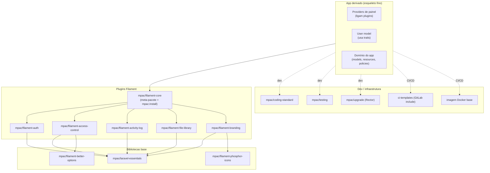

# Análise do Starter Template `filament-mpac`

> Auditoria do projeto como **template oficial para todos os apps Laravel da organização**: falhas, melhorias e plano de desmembramento em pacotes para que mudanças fundamentais cheguem aos apps antigos via `composer update`, sem edição manual repositório por repositório.
>
> Data da auditoria: 16/11/2026 · Base original analisada: `HEAD` (`67566a3`) · Suíte monolítica original: **208 testes passando (587 asserções), 111 s**.
> **Status em 18/11/2026:** ✅ **Desmembramento local implementado e validado** em `e:\codes\packages\*` (10 pacotes `mpac/*`) e template `filament-mpac` refatorado para esqueleto fino (`5` arquivos PHP em `app/`, `composer lint` + `composer analyze` com 0 erros, `composer test` com `13 passed / 152 assertions`). Restam apenas etapas externas de infraestrutura GitLab (Registry remoto, CI templates, imagem Docker base, pacote Rector `mpac/upgrade` e Renovate).

---

## Sumário executivo

**O que já está bom:** stack atual (PHP 8.4, Laravel 13, Filament 5, Livewire 4, Pest 5, Tailwind 4), `strict_types` em todo o código, PHPStan nível 8 com `bleedingEdge`, Pint com preset próprio, testes de arquitetura, policies baseadas em enums de permissão, imagem Docker multi-stage com FrankenPHP, pipeline GitLab com análise/estilo/testes/build e uma pasta `docs/` extensa. Vários problemas do diagnóstico anterior já foram corrigidos (bypass de `is_active`, campo de senha no `UserForm`, `<x-brand-logomark>`, eager loading de `media`).

**O problema estrutural:** quase todo o código em `app/`, `resources/`, `database/`, `lang/` e `config/` é **infraestrutura da organização** (autenticação LDAP/local, usuários/perfis/permissões, auditoria, biblioteca de arquivos, configurações do sistema, tema, ícones, traduções, CI, Docker). Num template clonado, esse código vira propriedade de cada app no momento do `create-project`. Corrigir um bug de LDAP ou ajustar o tema significa abrir N merge requests manuais, e os apps vão divergindo.

**O que fazer, em ordem:**

1. Corrigir as falhas críticas abaixo **antes** de gerar novos apps (principalmente escalonamento de privilégio e documentos públicos).
2. Extrair a infraestrutura para **pacotes Composer versionados** (plugins Filament + bibliotecas), publicados no GitLab Package Registry.
3. Centralizar o que não é PHP (CI, Docker, Pint/PHPStan/Rector, guidelines de IA) em **artefatos referenciados**, não copiados.
4. Automatizar a propagação: Renovate abrindo MRs nos apps, regras Rector para breaking changes e um comando `mpac:upgrade`.

O objetivo final é que o template vire um **esqueleto fino**: `composer.json`, providers de painel que ligam plugins, `User` com traits e o código de domínio do app.

---

## Parte 1 — Falhas encontradas

Severidade: 🔴 crítica · 🟠 alta · 🟡 média · ⚪ baixa.

### 🔴 1. Escalonamento de privilégio pelo cadastro de usuários

- **Onde:** `app/Filament/Resources/Users/Schemas/UserForm.php` (campo `roles`, linhas 46–51), `app/Policies/UserPolicy.php`, `database/seeders/RoleSeeder.php`.
- **Problema:** o perfil *Administrador* recebe `users.*`. O `CheckboxCards::make('roles')->relationship('roles', 'name')` lista **todos** os perfis, inclusive *Desenvolvedor* (que tem `*`). A `UserPolicy::update()` só checa `users.update`, sem olhar quem é o alvo. Resultado: um Administrador pode editar o próprio usuário, marcar *Desenvolvedor* e virar superusuário. No modo local, também pode trocar a senha de um Desenvolvedor e assumir a conta.
- **Correção:**
  - Filtrar as opções de perfil: o usuário só pode atribuir perfis cujas permissões sejam subconjunto das suas (ou bloquear perfis "protegidos" via enum/config).
  - Na policy, negar `update`/`delete` quando o alvo tem um perfil superior ao do ator, e negar auto-exclusão/auto-desativação.
  - Impedir remover o último Desenvolvedor.
  - Cobrir com testes de policy e de formulário.

### 🔴 2. Documentos e imagens servidos publicamente, sem autenticação

- **Onde:** `config/filesystems.php` (discos `images` e `documents`, linhas 51–67), `app/Models/Document.php`, `CopyFileUrlAction`.
- **Problema:** os dois discos ficam em `storage/app/public/...` com `visibility => public` e URL `/storage/documents/...`. A Media Library usa caminhos previsíveis (`{media_id}/{arquivo}`), então qualquer pessoa pode enumerar e baixar documentos sem login. Para um Ministério Público, isso é vazamento de dados.
- **Correção:** disco `documents` privado (`storage/app/private`), download por rota autenticada que passa pela `DocumentPolicy::view()`, ou `temporaryUrl()`/URL assinada com expiração. Manter público só o que é realmente público (logos e fundos de login). Avaliar o mesmo para `images`.

### 🔴 3. `Login` copiou e divergiu do fluxo do Filament (timing attack, MFA quebrado, sem checagem de painel)

- **Onde:** `app/Filament/Pages/Auth/Login.php`, comparado a `vendor/filament/filament/src/Auth/Pages/Login.php` (linhas 71–193).
- **Problema:** o `authenticate()` customizado reimplementa a lógica do vendor, mas a versão atual do Filament já evoluiu:
  - Não usa `Timebox`. Respostas de "usuário inexistente" e "senha errada" têm tempos diferentes, o que permite **enumerar usuários** (local e LDAP, onde a busca no diretório acontece antes do bind).
  - No modo local **não chama `canAccessPanel()`** antes do login (o vendor chama `isUserAllowedToAccessPanel()`). O usuário autentica e só depois leva 403 do middleware.
  - `checkMultiFactorAuthentication()` usa o formato antigo do Filament (`decrypt(...) === getAuthIdentifier()`). O vendor agora criptografa um array com `identifier` + `userKey`, tem rate limit do desafio MFA e usa `getMultiFactorChallenge()`. Se alguém ativar MFA, o fluxo quebra.
  - Não dispara o evento `Attempting`.
  - Dependências são resolvidas no `__construct()` (linhas 45–54). Funciona, mas o ponto de extensão do Livewire é `boot()`.
- **Correção recomendada:** parar de reimplementar o login.
  - **Modo local:** delegar para `parent::authenticate()` e customizar só os componentes do formulário.
  - **Modo LDAP:** usar o provider de autenticação do próprio LdapRecord-Laravel (`'driver' => 'ldap'` com `database` + `sync_attributes`), que faz bind, sincroniza o usuário local e funciona com o `parent::authenticate()` do Filament. A regra `requires_local` e o perfil padrão viram regras/listeners do LdapRecord (`Authenticating`, `Synchronized`).
  - Isso elimina a maior parte de `Login.php`, `LdapAuthService`, `LdapUserService` e da camada `AuthModeHandler`, e garante que as próximas correções de segurança do Filament cheguem automaticamente.

### 🟠 4. Redefinição de senha só existe quando o registro público está ligado

- **Onde:** `app/Providers/Filament/AppPanelProvider.php`, `configureRegistration()` (linhas 76–101).
- **Problema:** `->passwordReset()` está dentro do `if ($canRegister)`. No modo local, se o administrador desligar o autorregistro (o caso mais comum em sistemas internos), ninguém mais consegue recuperar a senha. O painel Admin também não registra `passwordReset()`.
- **Correção:** separar as duas coisas: `passwordReset()` depende só do modo local; `registration()` depende do setting.

### 🟠 5. Registro público ligado por padrão

- **Onde:** `app/Settings/SystemSettings.php` (`$enable_registration = true`), `app/Filament/Pages/Auth/Register.php`.
- **Problema:** todo app novo em modo local nasce aceitando cadastro anônimo. Além disso, `Register` atribui `UserRole::User` fixo, ignorando `config('auth.default_role')`, e usa o e-mail como `username`.
- **Correção:** padrão `false`. Usar `config('auth.default_role')`. Considerar verificação de e-mail (`->emailVerification()`) quando o registro estiver ligado.

### 🟠 6. Seeder cria contas com senhas triviais sem checar o ambiente

- **Onde:** `database/seeders/UserSeeder.php`, `DatabaseSeeder.php`.
- **Problema:** `developer/developer`, `admin/admin` e `user/user` são criados sempre que o seeder roda, inclusive em produção. `DB::prohibitDestructiveCommands()` bloqueia `migrate:fresh`, mas não bloqueia `db:seed`.
- **Correção:** separar `ProductionSeeder` (permissões e perfis) de `DevelopmentSeeder` (usuários fake), e abortar se `app()->isProduction()`. Em produção, criar o primeiro administrador via comando interativo (`mpac:create-admin`).

### 🟠 7. Formulário de usuário no modo LDAP aceita `username` vazio

- **Onde:** `UserForm::getUsernameComponent()` (linhas 84–103).
- **Problema:** no ramo LDAP, o campo não tem `required()` nem `maxLength()`. A coluna é `NOT NULL UNIQUE`, então salvar sem username estoura `QueryException` em vez de erro de validação. O e-mail é derivado só do evento `afterStateUpdated` (`live()->debounce(500)`): se o usuário salvar antes do debounce, o e-mail fica errado.
- **Correção:** `required()->maxLength()->unique(ignoreRecord: true)` nos dois modos e gerar o e-mail no `mutateFormDataBeforeSave/Create`, não no front.

### 🟠 8. `LoginResponse` manda para o painel errado

- **Onde:** `app/Http/Responses/LoginResponse.php`.
- **Problema:** depois do login, redireciona para `intended(Filament::getDefaultPanel()->getUrl())`. O perfil Administrador semeado só tem `panels.view.admin`. Se ele entrar direto por `/admin/login` (sem URL "intended"), vai para `/` (painel App), onde não tem acesso, e recebe 403.
- **Correção:** usar `Filament::getCurrentPanel()->getUrl()` como fallback, ou o primeiro painel que o usuário pode acessar.

### 🟡 9. HTTPS e proxies configurados "na mão"

- **Onde:** `AppServiceProvider::configureProductionUrl()` (linhas 46–53).
- **Problema:** sobrescreve `$_SERVER['HTTPS']` a partir de `X-Forwarded-Proto`, com padrão `'https'` quando o header não existe. Também acessa `request()` no `boot()`, que roda em comandos de console e workers.
- **Correção:** `->withMiddleware(fn ($m) => $m->trustProxies(at: [...], headers: ...))` em `bootstrap/app.php` mais `URL::forceScheme('https')`. Com isso também `request()->ip()` passa a vir correto para rate limit e auditoria.

### 🟡 10. Colunas `created_by` / `updated_by` órfãs

- **Onde:** migration `0001_01_01_000000_create_users_table.php` (linhas 28–36), `UsersTable.php` (linhas 53–61).
- **Problema:** nada preenche essas colunas, `User` não tem as relações e a FK não tem `nullOnDelete()`. Excluir um usuário que "criou" outro vai falhar por integridade referencial assim que alguém começar a preencher. A tabela mostra IDs numéricos.
- **Correção:** trait `HasBlameable` (no pacote de essentials) com `creating`/`updating`, relações `creator()`/`updater()`, `nullOnDelete()` e colunas exibindo `creator.name`. Ou remover as colunas, já que o activity log já registra o causador.

### 🟡 11. Pontos de extensão fixos no código (cada app nova precisa editar a base)

- `ActivityLog::subjectTypeOptions()` (`app/Support/ActivityLog.php`, linhas 44–53): lista fixa de models. Model novo não aparece no filtro de auditoria.
- `Panels` e `PanelPermissions::fromPanel()`: só existem `app` e `admin`. Um terceiro painel exige editar dois enums e o `PanelSwitcher`. O `AppPanelProvider` ainda usa `'app'` e `''` literais em vez do enum.
- `FileCollection`: discos, MIME types e diretórios num `match`. Cada app que precisar de uma coleção nova edita o enum base.
- `RoleSeeder`: permissões dos perfis padrão fixas.
- **Correção:** registries (`ActivityLog::registerSubject(Model::class, 'Rótulo')` ou interface `HasActivityLabel` no model), permissão de painel por convenção (`panels.view.{id}`) e coleções definidas em config.

### 🟡 12. Duplicação massiva de policies e enums de permissão

- Nove policies com ~100 linhas idênticas (`viewAny`, `view`, `create`, ... `reorder`), mudando só o enum. Nove enums com os mesmos 10 casos.
- **Correção:** classe base `ResourcePolicy` com `protected static string $permissions = UserPermissions::class` e uma interface/trait `ResourcePermissions` que resolve o caso pela ação. Cada policy nova vira 3 linhas. O seeder de permissões já descobre enums por diretório; trocar por um registry permite que pacotes registrem as próprias permissões.

### 🟡 13. Sincronização de permissões não remove nada e só roda via seeder

- **Onde:** `PermissionSeeder`.
- **Problema:** `firstOrCreate` por permissão (N queries). Permissões renomeadas ou removidas ficam no banco para sempre. Em apps antigos, permissões novas só chegam se alguém lembrar de rodar o seeder.
- **Correção:** comando idempotente `mpac:permissions:sync [--prune]`, executado no deploy (automação do container ou job de CI), com `upsert` em lote.

### 🟡 14. Serviços de domínio enviando notificação de UI

- **Onde:** `LdapUserService::findUserByUsername()` usa `HasNotifications::notifyError()`.
- **Problema:** um serviço de diretório disparando toast do Filament acopla a camada de serviço à UI e quebra em fila/console. `findUserByEmail()` nem trata exceções.
- **Correção:** o serviço lança uma exceção de domínio (`DirectoryUnavailableException`) e a página decide como exibir.

### 🟡 15. LDAP sem proteção contra senha vazia no serviço

- **Onde:** `LdapAuthService::authenticate()`.
- **Problema:** um bind LDAP com senha vazia pode ser tratado pelo servidor como bind anônimo/não autenticado e "passar". Hoje o formulário exige senha, mas o serviço não se protege.
- **Correção:** `if ($password === '') return false;`. Se migrar para o provider do LdapRecord (item 3), isso já é tratado.

### ⚪ 16. Higiene, código morto e configurações frágeis

| Item | Onde | Ação |
| --- | --- | --- |
| Traduções sem pacote correspondente | `lang/vendor/banner/` (nenhum pacote "banner" instalado) | Remover |
| 28 de 35 arquivos `pt_BR` do Filament divergem do vendor | `lang/vendor/filament-panels`, `filament-actions` | Manter só as chaves realmente customizadas; o resto envelhece a cada release do Filament |
| View e layout sem rota | `resources/views/welcome.blade.php`, `layouts/app.blade.php` | Remover |
| `janczakb/filament-flex-fields` só registra o plugin, não é usado por nenhum campo, e vários CSS/áudios dele estão versionados em `public/` | `AdminPanelProvider`, `public/` | Remover ou justificar |
| `FLEX_FIELDS_PLAYGROUND=true` no `.env.example` | `.env.example` | Remover (playground exposto em quem copiar o `.env`) |
| `laravel/sail` em dev, sem uso (Docker próprio + Laragon) | `composer.json` | Remover |
| Dois formatadores (Pint + PHP-CS-Fixer) | `.php-cs-fixer.php`, `composer.json` | Ficar só com Pint |
| `larastan/larastan` travado em `3.14` exato | `composer.json` | Usar `^3.14` |
| Pacotes da org sob vendor pessoal `tonegabes/*` e template com `name: tonegabes/filament-mpac` | `composer.json` | Migrar para namespace da org (ex.: `mpac/*`) no GitLab Package Registry: reduz dependência de uma pessoa |
| `lint-staged` roda `composer format` (projeto inteiro) e não re-adiciona os arquivos | `.lintstagedrc` | `"**/*.php": ["vendor/bin/pint"]` (lint-staged passa só os arquivos staged) |
| `\Str::random` via alias global e `Hash::make` redundante com o cast `hashed` | `Login::handleLocalUserRecord()` | `Str::random()` importado, sem `Hash::make` |
| `is_active` sem default na migration | migration de `users` | `->default(true)` |
| `AppPanelProvider` consulta o banco (settings) ao registrar o painel, em toda requisição e todo comando artisan | `configureRegistration()` | Usar cache do `spatie/laravel-settings` (`settings.cache.enabled`) ou checar dentro da página |

---

## Parte 2 — Melhorias recomendadas

### 2.1 Performance

- **`BrandLogomark` como componente Livewire** (`app/Livewire/BrandLogomark.php`): é renderizado em toda página (sidebar e telas de login), serializa estado e não tem nenhuma interação. Converter em componente Blade anônimo ou de classe.
- **`SystemSettings::getPublicFileUrl()`** chama `Storage::exists()` a cada render. Em disco S3/MinIO, isso é uma requisição HTTP por logo por página. Guardar o caminho validado no momento do upload e só montar a URL.
- **Cache de settings:** ativar `settings.cache.enabled` para evitar a query de `system` em toda requisição (painel e layouts de auth leem settings).
- **Fontes:** `components/head/fonts.blade.php` carrega 4 famílias com até 9 pesos cada de `fonts.bunny.net`, bloqueando a renderização. Em intranet, a CDN externa pode nem estar acessível. Auto-hospedar via Vite (`@fontsource/*`) só com os pesos usados.
- **Ordenação por `media.size`** em `DocumentsTable` ordena por relação morph. Validar o SQL gerado; se for lento, desnormalizar `size`/`mime_type` no próprio model.
- **Testes:** 111 s para 208 testes. Rodar `php artisan test --parallel` local e na CI, e usar `LazilyRefreshDatabase`.
- **Opcional (Laravel 12.8+):** `Model::automaticallyEagerLoadRelationships()` como proteção extra contra N+1 em tabelas Filament.

### 2.2 Segurança e padrões

- `Password::defaults()` centralizado (tamanho, `mixedCase`, `uncompromised()` em produção) e usado em `UserForm`, `Register` e reset de senha.
- `SESSION_SECURE_COOKIE=true` e `SESSION_ENCRYPT=true` no exemplo de produção.
- Caddyfile: adicionar `Content-Security-Policy` básica e `Strict-Transport-Security` (se o TLS terminar no proxy, documentar onde configurar).
- CI: `composer audit` e `npm audit --omit=dev` como jobs de qualidade, mais um limite mínimo de cobertura (`--coverage --min=`).
- CI: o build de imagem roda só para MR→`develop` e tags. Considerar build também em `main` para detectar quebra de imagem antes da tag.
- Dockerfile: `composer install --no-scripts` pula `filament:upgrade`. Hoje funciona porque os assets do Filament estão versionados em `public/`. Ao virar pacote, rodar `php artisan filament:assets` no stage de build e parar de versionar `public/js|css/filament`.
- Confirmar qual driver o `spatie/laravel-pdf` usa: `poppler-utils` na imagem não atende Browsershot (precisa de Chromium) nem DOMPDF.

### 2.3 Configuração enxuta

O Laravel 11+ não precisa de todos os arquivos em `config/`. Cada arquivo copiado congela os defaults da época do `create-project`. Rodar um diff contra `vendor/laravel/framework/config` e **manter só os arquivos com alterações reais** (provavelmente `auth.php`, `filesystems.php`, `permission.php`, `settings.php`). Valores da org devem vir dos pacotes via `mergeConfigFrom`.

### 2.4 Testes

- Faltam testes de autorização "negativos" com perfis reais (Admin tentando promover a si mesmo, editar Desenvolvedor, excluir a si mesmo).
- Falta teste de acesso anônimo a `/storage/documents/...` (vai falhar hoje, o que é o objetivo).
- Testes de arquitetura podem crescer com presets do Pest (`arch()->preset()->laravel()`, `->security()`) e regras da org (policies estendem `ResourcePolicy`, enums em `App\Enums\Permissions` implementam `ResourcePermissions`).

---

## Parte 3 — Desmembramento em pacotes

### 3.1 Princípio

**Tudo que deve ser igual em todos os apps vai para um pacote versionado. Tudo que é específico do app fica no app.** O app *consome* comportamento por configuração, plugins e contratos, e *nunca* edita código de infraestrutura.



### 3.2 Mapa de pacotes (o que sai de onde)

| Pacote | Conteúdo extraído do template | Pontos de extensão para o app |
| --- | --- | --- |
| **`mpac/laravel-essentials`** (evolução do `tonegabes/mpac-essentials`) | Helpers atuais (Mask, Money, Document, DateTime), `BetterEnum`, `HasIsActiveScope`, `HasBlameable` (novo), `HasNotifications`, hardening de produção hoje no `AppServiceProvider` (`shouldBeStrict`, `prohibitDestructiveCommands`, `forceScheme`, trust proxies, `Password::defaults()`) | Config `mpac-essentials.php` para ligar/desligar cada hardening |
| **`mpac/filament-auth`** | `AuthMode`, login local/LDAP (sobre o provider do LdapRecord), `Register`, reset de senha, `LoginResponse`, `ResetPasswordNotification` pt-BR, layouts de auth (`split`, `centered`, `fullpage`), `UsesConfiguredAuthLayout`, rota `/entrar` | `MpacAuthPlugin::make()->registration()->passwordReset()`; config `mpac-auth.php` (modo, domínio LDAP, `requires_local`, perfil padrão); eventos `UserProvisionedFromLdap` |
| **`mpac/filament-access-control`** | `Role`, `Permission`, `UserResource`, `RoleResource`, `PermissionResource`, `ResourcePolicy` base, `ResourcePermissions`, `PanelPermissions` por convenção, `PanelSwitcher`, `PermissionRegistry`, `mpac:permissions:sync`, `mpac:create-admin`, perfis padrão, proteção contra escalonamento (item 1) | `->userResource(MyUserResource::class)`, `->userFormSchema(fn)`; `PermissionRegistry::register(MyPermissions::class)` no provider do app; config de perfis protegidos |
| **`mpac/filament-activity-log`** | `ActivityResource`, `ActivitiesRelationManager`, `ViewActivitiesAction`, `ActivityLog` (rótulos), `ActivityPolicy`, permissões de auditoria, migration da tabela | Interface `HasActivityLabel` no model, ou `ActivityLog::registerSubject()`; tradução de atributos por model |
| **`mpac/filament-file-library`** | `Document`, `Image`, `MediaResource`, `DocumentResource`, `ImageResource`, `LibraryFileUpload`, `CopyFileUrlAction`, `HasFileUrl`, `FileLibrary`, discos, rota de download autenticado, policies e permissões | Config de coleções (disco, MIME, diretório, visibilidade) substituindo o `match` do `FileCollection`; resources liga/desliga no plugin |
| **`mpac/filament-branding`** | `SystemSettings` + migration de settings, `ManageSystem`, componente de logo (Blade), tema CSS (`resources/css/mpac-theme`), fontes auto-hospedadas, `BaseIconsProvider`, `OverrideActionsProvider`, render hooks, traduções pt-BR do Filament realmente customizadas | `MpacBrandingPlugin::make()->primaryColor()`; o app importa o CSS do pacote no `theme.css` e pode sobrescrever variáveis |
| **`mpac/filament-core`** | Meta-pacote que depende dos plugins acima, mais `MpacPlugin` que registra tudo com defaults da org e o comando `mpac:install` | `MpacPlugin::make()->withoutFileLibrary()` etc. |
| **`mpac/coding-standard`** (dev) | `pint.json`, `phpstan.neon` base (níveis, extensões, ignores comuns), `rector.php` base, `.editorconfig`, presets de arquitetura do Pest | O app tem só `includes:` / `--config` apontando para o vendor |
| **`mpac/testing`** (dev) | Helpers Pest (`actingAsDeveloper()`, `actingAsAdmin()`), factories de usuário com perfis, datasets de permissões, smoke test do painel | Uso direto nos testes do app |
| **`mpac/upgrade`** (dev) | Regras Rector por versão (`rector-v2.php`), comando `mpac:upgrade` | Executado quando um pacote sobe de major |

`tonegabes/filament-phosphor-icons` e `tonegabes/filament-better-options` já são pacotes; basta movê-los para o namespace da org. `laravel-make-model-plus` pode virar o gerador oficial com stubs que já criam policy herdando de `ResourcePolicy` e enum de permissões registrado.

### 3.3 Como o app fica depois

```php
// app/Providers/Filament/AdminPanelProvider.php
public function panel(Panel $panel): Panel
{
    return $panel
        ->id('admin')
        ->path('admin')
        ->plugins([
            MpacPlugin::make()
                ->auth(fn (MpacAuthPlugin $auth) => $auth->passwordReset())
                ->accessControl()
                ->activityLog()
                ->fileLibrary()
                ->branding(),
        ])
        ->discoverResources(in: app_path('Filament/Admin/Resources'), for: 'App\\Filament\\Admin\\Resources');
}
```

```php
// app/Models/User.php
class User extends Authenticatable implements FilamentUser, MpacUser
{
    use HasFactory, Notifiable;
    use InteractsWithMpacAccess; // HasRoles + canAccessPanel por convenção + is_active + activity log
}
```

```php
// app/Policies/ProcessoPolicy.php
final class ProcessoPolicy extends ResourcePolicy
{
    protected static string $permissions = ProcessoPermissions::class;
}
```

Hoje cada uma dessas áreas tem dezenas de arquivos no app. Depois, um bug no login LDAP é corrigido uma vez em `mpac/filament-auth`, sai como `1.4.1` e chega a todos os apps com `composer update`.

### 3.4 Regras de projeto para os pacotes

1. **Plugins Filament de verdade** (`Filament\Contracts\Plugin`), com `register(Panel)` e `boot(Panel)`, para que o app escolha por painel o que ligar.
2. **Classes trocáveis por config ou plugin.** Todo resource, model e page do pacote é referenciado por uma chave (`config('mpac-access.resources.user')`). O app estende a classe do pacote e troca a referência, sem copiar o arquivo.
3. **Models resolvidos por config**, nunca `App\Models\User` hardcoded (hoje a migration de `users` e o `config/auth.php` referenciam `App\Models\User`).
4. **Migrations carregadas pelo pacote** (`loadMigrationsFrom`), não publicadas. Assim, migrations novas chegam com o `composer update`. Para apps antigos que já têm as tabelas (`activity_log`, `media`, `permissions`, `settings`), as migrations do pacote devem ser idempotentes (`if (! Schema::hasTable(...))`) ou ter um comando `mpac:adopt` que marca as migrations como executadas.
5. **Settings migrations** do `spatie/laravel-settings` também carregadas a partir do pacote (`settings.migrations_paths`).
6. **Views e traduções com namespace** (`mpac-auth::`), publicáveis só se o app quiser sobrescrever. A regra é "não publique": cada arquivo publicado é um arquivo que para de receber atualização.
7. **Sem `vendor:publish` obrigatório.** O `mpac:install` só deve criar o que for inevitável (providers de painel, `theme.css` que importa o tema do pacote).
8. **Testados isoladamente** com Orchestra Testbench + Pest, com matriz de Laravel/Filament suportados.

---

## Parte 4 — Como atualizar apps antigos sem editar código manualmente

Os pacotes resolvem o PHP. O resto precisa de mecanismos próprios.

### 4.1 Distribuição e versionamento

- **Registry:** GitLab Package Registry (Composer) num grupo da org. Cada app declara o repositório uma vez no `composer.json`.
- **SemVer estrito:** patch = correção, minor = novidade compatível, major = breaking change com regra Rector correspondente.
- **`CHANGELOG.md` e `UPGRADE.md` em cada pacote.** Deprecar por pelo menos um minor antes de remover.
- **Constraints `^X.Y` nos apps**, nunca versões fixas, para que patches entrem sozinhos.

### 4.2 Propagação automática

- **Renovate** (self-hosted, rodando como job agendado no GitLab) sobre todos os repositórios de apps. Ele abre MRs de atualização dos pacotes `mpac/*` (e do resto). A pipeline do app roda testes e análise. Patches e minors podem ter automerge com pipeline verde.
- **Breaking changes:** o pacote publica `vendor/mpac/upgrade/rector-vX.php`. O Renovate (via `postUpgradeTasks`) ou o dev roda `vendor/bin/rector process --config vendor/mpac/upgrade/rector-v2.php`, e o código do app é ajustado automaticamente (renomeações de classe, assinatura de método, troca de trait).
- **`php artisan mpac:upgrade`:** comando que executa os passos não-PHP de uma major (sincronizar permissões, rodar migrations de adoção, limpar arquivos publicados obsoletos, avisar sobre overrides de view que divergiram).

### 4.3 Arquivos que não são PHP

| Artefato | Hoje | Proposta | Como o app referencia |
| --- | --- | --- | --- |
| Pipeline CI | `.gitlab-ci.yml` com ~230 linhas copiadas | Repositório `sistemas/ci-templates` com tags (`v1`, `v1.2`) | `include: { project: 'sistemas/ci-templates', ref: 'v1', file: '/laravel-app.yml' }`; o app só define variáveis |
| Docker | `Dockerfile` completo, `Caddyfile`, `docker/php/opcache.ini` | Imagem base da org (`registry.mpac.mp.br/sistemas/docker-images/laravel-frankenphp:8.4`) com extensões, Caddyfile, opcache e usuário | `Dockerfile` do app com ~15 linhas (`FROM` base, `composer install`, `npm run build`) |
| Pint / PHPStan / Rector | `pint.json` (180 linhas), `phpstan.neon`, `.php-cs-fixer.php` | `mpac/coding-standard` | `phpstan.neon`: `includes: [vendor/mpac/coding-standard/phpstan.neon]`; scripts: `pint --config vendor/mpac/coding-standard/pint.json` |
| Tema CSS | `resources/css/mpac-theme/*` | `mpac/filament-branding` | `@import '../../../vendor/mpac/filament-branding/resources/css/theme.css';` e `@source` para as views do vendor |
| Guidelines de IA | `AGENTS.md`, `.cursor/skills`, `GEMINI.md`, `boost.json` | Guidelines e skills dentro dos pacotes (`resources/boost/guidelines/*.blade.php`), que o Laravel Boost agrega automaticamente | `php artisan boost:update` regenera o `AGENTS.md` de cada app com as regras da org |
| Hooks Git | `.husky`, `.lintstagedrc` | Manter no esqueleto (são pequenos e estáveis) | — |

### 4.4 O que inevitavelmente fica no app

Algumas coisas sempre vão morar no repositório do app: `bootstrap/app.php`, `bootstrap/providers.php`, `composer.json`, `.env.example`, providers de painel, `User.php`. Para manter esses arquivos alinhados ao template sem edição manual, há duas opções:

- **Copier** (`copier copy` / `copier update`): gera o app a partir do template e depois aplica as mudanças do template com merge de 3 vias, respeitando as alterações locais. O template guarda as respostas (nome do app, modo de auth, painéis) em `.copier-answers.yml`.
- **Manter esses arquivos mínimos** para que quase nunca mudem. Por exemplo, `bootstrap/app.php` chamando `Mpac::configure($middleware, $exceptions)` em vez de listar middlewares.

A segunda opção já resolve quase tudo. Copier vale se o esqueleto continuar mudando com frequência.

---

## Parte 5 — Roteiro sugerido

| Fase | Entregas | Resultado |
| --- | --- | --- |
| **0. Correções urgentes** (no template atual) | Itens 1, 2, 3 (pelo menos `Timebox` e checagem de painel), 4, 5, 6, 7; testes negativos de autorização | Template seguro para gerar apps novos já |
| **1. Fundação** | Namespace `mpac/*` no GitLab Package Registry; `mpac/coding-standard`; `ci-templates`; imagem Docker base; Renovate configurado | CI, Docker e estilo atualizáveis em todos os apps imediatamente, mesmo antes de extrair código PHP |
| **2. Bibliotecas base** | `mpac/laravel-essentials` (absorve traits e hardening), `ResourcePolicy`, `PermissionRegistry`, `mpac:permissions:sync`, `mpac/testing` | Menos código duplicado no app; permissões sincronizadas no deploy |
| **3. Plugins Filament** | Na ordem de menor acoplamento: `branding` → `activity-log` → `file-library` → `access-control` → `auth`; depois `filament-core` + `mpac:install` | Template vira esqueleto fino |
| **4. Adoção pelos apps antigos** | `mpac:adopt` (marca migrations existentes, remove arquivos duplicados), regras Rector para trocar `App\...` pelas classes do pacote, MR guiado por app | Apps legados passam a receber updates por `composer update` |
| **5. Operação contínua** | SemVer + changelog, Renovate com automerge de patch, matriz de testes por versão do Laravel/Filament | Mudança fundamental = 1 release + MRs automáticos |

Recomendação de ordem dentro da fase 3: começar por **branding**, porque é o mais visível, tem menos lógica e valida toda a cadeia (registry, Renovate, import de CSS do vendor, views com namespace) com baixo risco. **Auth** fica por último porque é o mais sensível e se beneficia de já ter `access-control` como dependência.

---

## Apêndice — Itens do diagnóstico anterior

| Item | Situação |
| --- | --- |
| Bypass de `is_active` no login local/LDAP e em `canAccessPanel()` | ✅ Corrigido |
| `UserForm` sem campo de senha no modo local | ✅ Corrigido |
| Layouts de auth usando `<x-brand-logomark>` inexistente | ✅ Corrigido (agora `<livewire:brand-logomark />`; ver item 2.1 sobre trocar por Blade) |
| N+1 / lazy loading de `media` em Documentos e Imagens | ✅ Corrigido (`->with('media')`) |
| Resolução de dependências no `__construct()` do `Login` | ✅ Corrigido (`Login::boot()` em `mpac/filament-auth`) |
| `created_by` / `updated_by` órfãos | ✅ Corrigido (`HasBlameable` em `mpac/laravel-essentials` + `nullOnDelete()`) |
| `ActivityLog` e `PanelPermissions` fixos no código | ✅ Corrigido (`ActivityLog::registerSubject()`, `HasActivityLabel`, fallback `panels.view.{id}`) |

---

## Parte 6 — Consolidação da Implementação Realizada (`18/11/2026`)

O plano detalhado em [PLANO_DESMEMBRAMENTO_PACOTES.md](file:///e:/laragon/www/filament-mpac/PLANO_DESMEMBRAMENTO_PACOTES.md) foi executado nos repositórios locais em `e:\codes\packages\*` e integrado no template `filament-mpac`:

- **Pacotes implementados e validados com Pint (`--test`), PHPStan Nível 8 (`bleedingEdge`) e Pest:**
  - `mpac/php-quality` (`e:\codes\packages\php-quality`) — preset compartilhado Pint/PHPStan (equivalente ao `mpac/coding-standard` proposto).
  - `mpac/laravel-essentials` (`e:\codes\packages\laravel-essentials`) — `4 passed (27 assertions)`.
  - `mpac/filament-auth` (`e:\codes\packages\filament-auth`) — `11 passed (44 assertions)`.
  - `mpac/filament-auth-external` (`e:\codes\packages\filament-auth-external`) — autenticação externa OAuth2/OIDC via Socialite — `4 passed (27 assertions)`.
  - `mpac/filament-access-control` (`e:\codes\packages\filament-access-control`) — `3 passed (24 assertions)`.
  - `mpac/filament-activity-log` (`e:\codes\packages\filament-activity-log`) — `3 passed (17 assertions)`.
  - `mpac/filament-file-library` (`e:\codes\packages\filament-file-library`) — `3 passed (22 assertions)`.
  - `mpac/filament-branding` (`e:\codes\packages\filament-branding`) — `4 passed (30 assertions)`.
  - `mpac/filament-core` (`e:\codes\packages\filament-core`) — `MpacPlugin`, `mpac:install` e `mpac:adopt` — `3 passed (30 assertions)`.
  - `mpac/testing` (`e:\codes\packages\testing`) — `MpacTestCase` e `InteractsWithMpacUsers` — `3 passed (15 assertions)`.
- **Template `filament-mpac` (Esqueleto Fino):**
  - `app/` enxugado de 95 arquivos PHP para **5 arquivos** (`Controller.php`, `User.php`, `AppServiceProvider.php`, `AdminPanelProvider.php`, `AppPanelProvider.php`).
  - `bootstrap/providers.php` reduzido para **3 providers**; `database/migrations/` para **4 migrations**; `resources/views/` para **1 view** (`vendor/pulse/dashboard.blade.php`).
  - Validado no template com `composer lint` (`passed`), `composer analyze` (`0 erros`) e `composer test` (`13 passed (152 assertions)`).
- **Pendências de infraestrutura externa (fora do código local):** publicação de tags no GitLab Composer Package Registry, criação dos repositórios `sistemas/ci-templates` e `sistemas/docker-images`, pacote Rector `mpac/upgrade`, atualização do `mpac/laravel-make-model-plus` e configuração do Renovate Bot.
