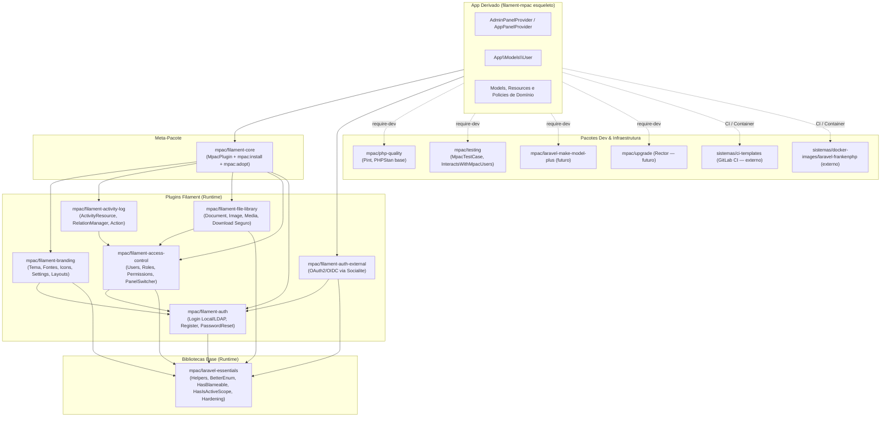

# Plano de Desmembramento em Pacotes — `filament-mpac`

> **Documento Operacional e Guia de Execução (Passo a Passo + Checklist)**
> Baseado na auditoria de [ANALISE_ARQUITETURAL_E_PACOTES.md](file:///e:/laragon/www/filament-mpac/ANALISE_ARQUITETURAL_E_PACOTES.md) e atualizado após a execução completa do desmembramento local em `e:\codes\packages\*` e integração no template `filament-mpac` (`18/11/2026`).

---

## 1. Diagnóstico e Status da Execução (`18/11/2026`)

### 1.1 O que já foi implementado no template (Fase 0 concluída no código)

Desde a emissão de `ANALISE_ARQUITETURAL_E_PACOTES.md`, o commit `896df8b` já implementou no próprio template a maior parte das correções críticas e abstrações preparatórias:

| Item da Análise Original | Estado Atual no Repositório (`896df8b`) | Arquivos Criados / Modificados |
| :--- | :--- | :--- |
| **1. Proteção contra escalonamento de privilégio** | ✅ **Implementado** | `User::isSuperAdmin()`, `User::canAssignRole()`, `User::canManageUser()`, `User::isLastDeveloper()`, `UserPolicy`, `UserForm`, `CreateUser`, `EditUser` |
| **2. Documentos e imagens privados** | ✅ **Implementado** | `config/filesystems.php` (`private`), `FileDownloadController`, `routes/web.php` (`documents.download`, `images.download`, `media.download`) |
| **3. Refatoração parcial do `Login`** | ✅ **Parcialmente implementado** | `Login::boot()`, delegação para `parent::authenticate()` no modo `Local`, `Timebox` e `isUserAllowedToAccessPanel()` no modo `Ldap` |
| **4. Reset de senha desacoplado do registro** | ✅ **Implementado** | `AppPanelProvider::configureLocalAuthFeatures()` e `AdminPanelProvider::panel()` |
| **5. Registro público desligado por padrão** | ✅ **Implementado** | `SystemSettings::$enable_registration = false`, migration de settings atualizada, `Register` usando `config('auth.default_role')` |
| **6. Separação de Seeders Prod vs Dev** | ✅ **Implementado** | `ProductionSeeder`, `DevelopmentSeeder`, `CreateAdminCommand` (`mpac:create-admin`) |
| **7. Validação de `username` no modo LDAP** | ✅ **Implementado** | `UserForm`, `CreateUser`, `EditUser` |
| **8. Redirecionamento pós-login por painel** | ✅ **Implementado** | `LoginResponse` verifica `canAccessPanel()` no painel atual e demais painéis |
| **9. Proxy reverso e HTTPS** | ✅ **Implementado** | `bootstrap/app.php` (`trustProxies(at: '*')`) e `AppServiceProvider` (`URL::forceScheme('https')`) |
| **10. Rastreabilidade `created_by` / `updated_by`** | ✅ **Implementado** | Trait `HasBlameable`, `nullOnDelete()` na migration de `users`, `UsersTable` exibindo `creator.name`/`updater.name` |
| **11. Desacoplamento de `ActivityLog` e `PanelSwitcher`** | ✅ **Parcialmente implementado** | Interface `HasActivityLabel`, `ActivityLog::registerSubject()`, `PanelSwitcher` dinâmico com fallback |
| **12. Classe base `ResourcePolicy` e contrato** | ✅ **Implementado** | `ResourcePolicy`, contrato `ResourcePermissions`, trait `ResolvesResourcePermissions` |
| **13. Comando `mpac:permissions:sync`** | ✅ **Implementado** | `SyncPermissionsCommand` com `upsert` em lote e flag `--prune` |
| **14 & 15. Exceção de domínio LDAP e senha vazia** | ✅ **Implementado** | `DirectoryUnavailableException`, `LdapUserService` sem toast de UI, `LdapAuthService` rejeitando senha vazia |
| **16. Higiene inicial** | ✅ **Parcialmente implementado** | Removidos `.php-cs-fixer.php`, `welcome.blade.php`, `layouts/app.blade.php`, `lang/vendor/banner/` |

---

### 1.2 Acoplamentos Cruzados Restantes (Bloqueadores para Extração Limpa)

A análise minuciosa do código atual revelou **7 acoplamentos internos** que precisam ser desfeitos **durante** a extração para evitar dependências circulares entre os pacotes `mpac/*`:

1. **`ManageSystem` / `SystemSettings` (Branding vs Auth vs File Library):**
   - `ManageSystem` (`app/Filament/Pages/Settings/ManageSystem.php`) usa `LibraryFileUpload::publicImage()` e `FileCollection::SystemLogos` / `FileCollection::SystemBackgrounds`. Se `mpac/filament-branding` for extraído antes de `mpac/filament-file-library`, ele **não pode** depender de `LibraryFileUpload` nem de `FileCollection`. Como logos e fundos de tela usam o `FileUpload` nativo do Filament no disco `public` (e não Spatie Media Library), esse método deve ir diretamente para `mpac/filament-branding`.
   - `SystemSettings` guarda `enable_registration` (usado por `AppPanelProvider` / `mpac/filament-auth`) e `auth_page_layout` / `auth_page_background` (usados por `UsesConfiguredAuthLayout`). A solução limpa é manter `SystemSettings` e os layouts de página em `mpac/filament-branding` (ou ler via contrato `ProvidesAuthSettings`), permitindo que `mpac/filament-auth` consuma essas configurações com fallback seguro caso `mpac/filament-branding` não esteja instalado.
2. **`SyncPermissionsCommand` lê apenas `app_path('Enums/Permissions')`:**
   - Em `app/Console/Commands/SyncPermissionsCommand.php`, a descoberta de permissões varre apenas arquivos físicos em `app/Enums/Permissions`. Quando `UserPermissions`, `ActivityPermissions`, `DocumentPermissions` etc. migrarem para seus respectivos pacotes em `vendor/mpac/*`, eles deixarão de existir em `app/Enums/Permissions`.
   - **Solução:** Criar a classe `PermissionRegistry` (em `mpac/laravel-essentials` ou `mpac/filament-access-control`) onde cada pacote registra seus enums (`PermissionRegistry::register([ActivityPermissions::class])`) no `ServiceProvider`, mantendo a varredura de `app_path('Enums/Permissions')` apenas para os enums de domínio do próprio app.
3. **`ActivityLog::subjectTypeOptions()` referencia models fixos de outros pacotes:**
   - Em `app/Support/ActivityLog.php` (linhas 68–77), há imports diretos de `App\Models\User`, `Document`, `Image`, `Role`, `Permission`.
   - **Solução:** `ActivityLog::$registeredSubjects` deve iniciar vazio no pacote `mpac/filament-activity-log`. O pacote `mpac/filament-file-library` registra `Document` e `Image` no seu `boot()`, e `mpac/filament-access-control` registra `User`, `Role` e `Permission`.
4. **Referências hardcoded a `App\Models\User`:**
   - `HasBlameable`, `ResourcePolicy`, `ViewActivitiesAction`, `PanelSwitcher` e `LoginResponse` importam `App\Models\User` diretamente.
   - **Solução:** Nos pacotes, tipar contra `Illuminate\Contracts\Auth\Authenticatable` / `Filament\Models\Contracts\FilamentUser` (ou contrato `Mpac\Contracts\MpacUser`) e resolver a classe concreta via `config('auth.providers.users.model')`.
5. **`FileCollection` enum fechado (`match` hardcoded):**
   - `app/Enums/FileCollection.php` fixa `Images`, `Documents`, `SystemLogos` e `SystemBackgrounds`.
   - **Solução:** Mover `SystemLogos` e `SystemBackgrounds` para constantes/config do `mpac/filament-branding` e transformar as coleções do `mpac/filament-file-library` em configuração extensível (`config/mpac-file-library.php`), mantendo `FileCollection` como enum padrão ou Value Object configurável.
6. **`BrandLogomark` ainda é componente Livewire + I/O em `SystemSettings`:**
   - `app/Livewire/BrandLogomark.php` monta um componente Livewire inteiro só para exibir a logo estática, e `SystemSettings::getPublicFileUrl()` executa `$disk->exists($path)` a cada requisição.
   - **Solução:** Ao extrair `mpac/filament-branding`, converter `<livewire:brand-logomark />` em componente Blade anônimo `<x-mpac-branding::brand-logomark />` e montar a URL pública diretamente sem `exists()` por request.
7. **Resíduos estáticos de `filament-flex-fields` em `public/`:**
   - Embora o pacote não esteja no `composer.json`, dezenas de arquivos `.css`, `.js` e `.mp3` continuam versionados em `public/css/janczakb/`, `public/js/janczakb/` e `public/audio/janczakb/`. Devem ser removidos na limpeza pré-extração.

---

## 2. Arquitetura Alvo e Grafo de Dependências



### Ordem Estrita de Extração (Implementada)

1. **Camada Dev & Padrões:** `mpac/php-quality` (local; `sistemas/docker-images` e `sistemas/ci-templates` permanecem como passos externos de infra GitLab)
2. **Camada Base Runtime:** `mpac/laravel-essentials`
3. **Camada Base Dev:** `mpac/testing`
4. **Camada Plugins Filament:**
   - `1º` **`mpac/filament-auth`** (autenticação local/LDAP, `AuthMode`, `Login`, `Register`, `Password`, `LoginResponse`, contrato `ResolvesAuthSettings`)
   - `2º` **`mpac/filament-access-control`** (permissões, roles, `UserResource`, `RoleResource`, `PermissionResource`, `PermissionRegistry`, `ResourcePolicy`, `PanelSwitcher`, `InteractsWithAccessControl`)
   - `3º` **`mpac/filament-activity-log`** (`ActivityResource`, `ActivitiesRelationManager`, `ViewActivitiesAction`, `ActivityPolicy`, `ActivityLog`, `HasActivityLabel`)
   - `4º` **`mpac/filament-file-library`** (`Document`, `Image`, `MediaResource`, `DocumentResource`, `ImageResource`, `LibraryFileUpload`, `CopyFileUrlAction`, `FileDownloadController`)
   - `5º` **`mpac/filament-branding`** (`SystemSettings`, `ManageSystem`, `PageLayouts`, `SystemPermissions`, `BaseIcons`, `ActionOverrides`, `ResetPasswordNotification`, layouts de auth e `<x-mpac-branding::brand-logomark />`)
   - `6º` **`mpac/filament-auth-external`** (OAuth2/OIDC com Laravel Socialite)
5. **Camada Agregadora e Esqueleto:** `mpac/filament-core` (`MpacPlugin`, `mpac:install`, `mpac:adopt`) → integração no `filament-mpac` (`mpac/upgrade` e `laravel-make-model-plus` ficam para a etapa de governança/automação remota).

---

## 3. Mapeamento Completo Arquivo-por-Arquivo (De → Para)

### 3.1 Arquivos de `app/`

| Arquivo Atual no Template | Destino | Namespace / Classe Alvo |
| :--- | :--- | :--- |
| `app/Contracts/HasActivityLabel.php` | `mpac/filament-activity-log` | `Mpac\FilamentActivityLog\Contracts\HasActivityLabel` |
| `app/Contracts/HasFileUrl.php` | `mpac/filament-file-library` | `Mpac\FilamentFileLibrary\Contracts\HasFileUrl` |
| `app/Contracts/ResourcePermissions.php` | `mpac/filament-access-control` | `Mpac\FilamentAccessControl\Contracts\ResourcePermissions` |
| `app/Traits/HasBlameable.php` | `mpac/laravel-essentials` | `Mpac\LaravelEssentials\Concerns\HasBlameable` |
| `app/Traits/HasIsActiveScope.php` | `mpac/laravel-essentials` | `Mpac\LaravelEssentials\Concerns\HasIsActiveScope` |
| `app/Traits/HasNotifications.php` | Removido (substituído por `DirectoryUnavailableException` na camada de domínio) | — |
| `app/Traits/ResolvesResourcePermissions.php` | `mpac/filament-access-control` | `Mpac\FilamentAccessControl\Concerns\DefinesResourcePermissions` |
| `app/Policies/ResourcePolicy.php` | `mpac/filament-access-control` | `Mpac\FilamentAccessControl\Policies\ResourcePolicy` |
| `app/Enums/NavGroups.php` | `mpac/filament-access-control` | `Mpac\FilamentAccessControl\Enums\NavGroups` |
| `app/Enums/Panels.php` | `mpac/filament-access-control` | `Mpac\FilamentAccessControl\Enums\Panels` |
| `app/Enums/Permissions/WildcardPermissions.php` | `mpac/filament-access-control` | `Mpac\FilamentAccessControl\Enums\Permissions\WildcardPermissions` |
| `app/Enums/Permissions/PanelPermissions.php` | `mpac/filament-access-control` | `Mpac\FilamentAccessControl\Enums\Permissions\PanelPermissions` |
| `app/Enums/Permissions/SystemPermissions.php` | `mpac/filament-branding` | `Mpac\FilamentBranding\Enums\SystemPermissions` |
| `app/Enums/PageLayouts.php` | `mpac/filament-branding` | `Mpac\FilamentBranding\Enums\PageLayouts` |
| `app/Settings/SystemSettings.php` | `mpac/filament-branding` | `Mpac\FilamentBranding\Settings\SystemSettings` |
| `app/Filament/Pages/Settings/ManageSystem.php` | `mpac/filament-branding` | `Mpac\FilamentBranding\Pages\ManageSystem` |
| `app/Livewire/BrandLogomark.php` | `mpac/filament-branding` | View Component Blade `Mpac\FilamentBranding\View\Components\BrandLogomark` |
| `app/Providers/Filament/BaseIconsProvider.php` | `mpac/filament-branding` | `Mpac\FilamentBranding\Support\BaseIcons` |
| `app/Providers/Filament/OverrideActionsProvider.php` | `mpac/filament-branding` | `Mpac\FilamentBranding\Support\ActionOverrides` |
| `app/Providers/Filament/RenderHooksProvider.php` | `mpac/filament-branding` | Incorporado ao `FilamentBrandingServiceProvider` |
| `app/Filament/Pages/Auth/Concerns/UsesConfiguredAuthLayout.php` | `mpac/filament-auth` | `Mpac\FilamentAuth\Pages\Concerns\UsesConfiguredAuthLayout` + `ResolvesAuthSettings` |
| `app/Support/ActivityLog.php` | `mpac/filament-activity-log` | `Mpac\FilamentActivityLog\Support\ActivityLog` |
| `app/Enums/Permissions/ActivityPermissions.php` | `mpac/filament-activity-log` | `Mpac\FilamentActivityLog\Enums\Permissions\ActivityPermissions` |
| `app/Policies/ActivityPolicy.php` | `mpac/filament-activity-log` | `Mpac\FilamentActivityLog\Policies\ActivityPolicy` |
| `app/Filament/Actions/ViewActivitiesAction.php` | `mpac/filament-activity-log` | `Mpac\FilamentActivityLog\Filament\Actions\ViewActivitiesAction` |
| `app/Filament/RelationManagers/ActivitiesRelationManager.php` | `mpac/filament-activity-log` | `Mpac\FilamentActivityLog\Filament\RelationManagers\ActivitiesRelationManager` |
| `app/Filament/Resources/Activities/**` | `mpac/filament-activity-log` | `Mpac\FilamentActivityLog\Filament\Resources\Activities\**` |
| `app/Enums/FileCollection.php` | `mpac/filament-file-library` | `Mpac\FilamentFileLibrary\Enums\FileCollection` |
| `app/Support/FileLibrary.php` | `mpac/filament-file-library` | `Mpac\FilamentFileLibrary\Support\FileLibrary` |
| `app/Filament/Support/LibraryFileUpload.php` | `mpac/filament-file-library` | `Mpac\FilamentFileLibrary\Filament\Forms\LibraryFileUpload` |
| `app/Filament/Actions/CopyFileUrlAction.php` | `mpac/filament-file-library` | `Mpac\FilamentFileLibrary\Filament\Actions\CopyFileUrlAction` |
| `app/Http/Controllers/FileDownloadController.php` | `mpac/filament-file-library` | `Mpac\FilamentFileLibrary\Http\Controllers\FileDownloadController` |
| `app/Models/Document.php` | `mpac/filament-file-library` | `Mpac\FilamentFileLibrary\Models\Document` |
| `app/Models/Image.php` | `mpac/filament-file-library` | `Mpac\FilamentFileLibrary\Models\Image` |
| `app/Policies/DocumentPolicy.php` | `mpac/filament-file-library` | `Mpac\FilamentFileLibrary\Policies\DocumentPolicy` |
| `app/Policies/ImagePolicy.php` | `mpac/filament-file-library` | `Mpac\FilamentFileLibrary\Policies\ImagePolicy` |
| `app/Policies/MediaPolicy.php` | `mpac/filament-file-library` | `Mpac\FilamentFileLibrary\Policies\MediaPolicy` |
| `app/Enums/Permissions/DocumentPermissions.php` | `mpac/filament-file-library` | `Mpac\FilamentFileLibrary\Enums\Permissions\DocumentPermissions` |
| `app/Enums/Permissions/ImagePermissions.php` | `mpac/filament-file-library` | `Mpac\FilamentFileLibrary\Enums\Permissions\ImagePermissions` |
| `app/Enums/Permissions/MediaPermissions.php` | `mpac/filament-file-library` | `Mpac\FilamentFileLibrary\Enums\Permissions\MediaPermissions` |
| `app/Filament/Resources/Documents/**` | `mpac/filament-file-library` | `Mpac\FilamentFileLibrary\Filament\Resources\Documents\**` |
| `app/Filament/Resources/Images/**` | `mpac/filament-file-library` | `Mpac\FilamentFileLibrary\Filament\Resources\Images\**` |
| `app/Filament/Resources/Media/**` | `mpac/filament-file-library` | `Mpac\FilamentFileLibrary\Filament\Resources\Media\**` |
| `app/Enums/UserRole.php` | `mpac/filament-access-control` | `Mpac\FilamentAccessControl\Enums\UserRole` |
| `app/Enums/Permissions/UserPermissions.php` | `mpac/filament-access-control` | `Mpac\FilamentAccessControl\Enums\Permissions\UserPermissions` |
| `app/Enums/Permissions/RolePermissions.php` | `mpac/filament-access-control` | `Mpac\FilamentAccessControl\Enums\Permissions\RolePermissions` |
| `app/Enums/Permissions/PermissionPermissions.php` | `mpac/filament-access-control` | `Mpac\FilamentAccessControl\Enums\Permissions\PermissionPermissions` |
| `app/Models/Role.php` | `mpac/filament-access-control` | `Mpac\FilamentAccessControl\Models\Role` |
| `app/Models/Permission.php` | `mpac/filament-access-control` | `Mpac\FilamentAccessControl\Models\Permission` |
| `app/Policies/UserPolicy.php` | `mpac/filament-access-control` | `Mpac\FilamentAccessControl\Policies\UserPolicy` |
| `app/Policies/RolePolicy.php` | `mpac/filament-access-control` | `Mpac\FilamentAccessControl\Policies\RolePolicy` |
| `app/Policies/PermissionPolicy.php` | `mpac/filament-access-control` | `Mpac\FilamentAccessControl\Policies\PermissionPolicy` |
| `app/Filament/Components/Navigation/PanelSwitcher.php` | `mpac/filament-access-control` | `Mpac\FilamentAccessControl\Support\PanelSwitcher` |
| `app/Console/Commands/CreateAdminCommand.php` | `mpac/filament-access-control` | `Mpac\FilamentAccessControl\Commands\CreateAdminCommand` |
| `app/Console/Commands/SyncPermissionsCommand.php` | `mpac/filament-access-control` | `Mpac\FilamentAccessControl\Commands\SyncPermissionsCommand` |
| `app/Filament/Resources/Users/**` | `mpac/filament-access-control` | `Mpac\FilamentAccessControl\Filament\Resources\Users\**` |
| `app/Filament/Resources/Roles/**` | `mpac/filament-access-control` | `Mpac\FilamentAccessControl\Filament\Resources\Roles\**` |
| `app/Filament/Resources/Permissions/**` | `mpac/filament-access-control` | `Mpac\FilamentAccessControl\Filament\Resources\Permissions\**` |
| `app/Enums/AuthMode.php` | `mpac/filament-auth` | `Mpac\FilamentAuth\Enums\AuthMode` |
| `app/Exceptions/DirectoryUnavailableException.php` | `mpac/filament-auth` | `Mpac\FilamentAuth\Exceptions\DirectoryUnavailableException` |
| `app/Services/Auth/**` | `mpac/filament-auth` | `Mpac\FilamentAuth\Auth\**` + `Mpac\FilamentAuth\Ldap\**` |
| `app/Http/Responses/LoginResponse.php` | `mpac/filament-auth` | `Mpac\FilamentAuth\Http\Responses\LoginResponse` |
| `app/Notifications/ResetPasswordNotification.php` | `mpac/filament-branding` | `Mpac\FilamentBranding\Notifications\ResetPasswordNotification` |
| `app/Providers/Filament/OverrideNotificationsProvider.php` | `mpac/filament-branding` | Incorporado ao `FilamentBrandingServiceProvider` |
| `app/Filament/Pages/Auth/Login.php` | `mpac/filament-auth` | `Mpac\FilamentAuth\Pages\Login` |
| `app/Filament/Pages/Auth/Register.php` | `mpac/filament-auth` | `Mpac\FilamentAuth\Pages\Register` |
| `app/Filament/Pages/Auth/Password/**` | `mpac/filament-auth` | `Mpac\FilamentAuth\Pages\Password\**` |
| *(Novo)* Autenticação externa OAuth2/OIDC | `mpac/filament-auth-external` | `Mpac\FilamentAuthExternal\FilamentAuthExternalPlugin` |
| `app/Models/User.php` | **Permanece no App** | Enxugado usando `HasAuthDriver` + `InteractsWithAccessControl` (81 linhas com PHPDoc) |
| `app/Providers/AppServiceProvider.php` | **Permanece no App** | Enxugado apenas com o Gate do Pulse (hardening em `EssentialsServiceProvider`) |
| `app/Providers/Filament/AdminPanelProvider.php` | **Permanece no App** | Enxugado usando `MpacPlugin::make()` + `FilamentAuthExternalPlugin::make()` |
| `app/Providers/Filament/AppPanelProvider.php` | **Permanece no App** | Enxugado usando `MpacPlugin::make()` + `FilamentAuthExternalPlugin::make()` |

### 3.2 Arquivos de `database/`, `resources/`, `routes/`, `lang/` e DevOps

| Arquivo Atual no Template | Destino | Como será carregado |
| :--- | :--- | :--- |
| `database/migrations/2022_12_14_083707_create_settings_table.php` | `mpac/filament-branding` | `loadMigrationsFrom()` com checagem `Schema::hasTable('settings')` |
| `database/settings/2025_08_22_165843_create_system_settings.php` | `mpac/filament-branding` | Registrado em `config('settings.migrations_paths')` pelo pacote |
| `database/migrations/2025_09_22_180234_create_activity_log_table.php` | `mpac/filament-activity-log` | `loadMigrationsFrom()` com checagem `Schema::hasTable('activity_log')` |
| `database/migrations/2025_08_25_161333_create_media_table.php` | `mpac/filament-file-library` | `loadMigrationsFrom()` com checagem `Schema::hasTable('media')` |
| `database/migrations/2025_08_28_171358_create_images_table.php` | `mpac/filament-file-library` | `loadMigrationsFrom()` com checagem `Schema::hasTable('images')` |
| `database/migrations/2025_08_29_152539_create_documents_table.php` | `mpac/filament-file-library` | `loadMigrationsFrom()` com checagem `Schema::hasTable('documents')` |
| `database/migrations/2025_08_13_193244_create_permission_tables.php` | `mpac/filament-access-control` | `loadMigrationsFrom()` com checagem `Schema::hasTable('permissions')` |
| `database/seeders/PermissionSeeder.php` e `RoleSeeder.php` | Mantidos no App usando enums/models de `Mpac\*` | `Database\Seeders\**` |
| `resources/css/mpac-theme/**` e `resources/css/filament/**` | `mpac/filament-branding` | Importado pelo `resources/css/mpac-theme/index.css` do app via `@import "../../../vendor/mpac/filament-branding/resources/css/index.css";` |
| `resources/views/components/brand-logo.blade.php`, `livewire/brand-logomark.blade.php`, `hooks/head-end.blade.php`, `components/head/**`, `layouts/auth/**`, `components/section/auth.blade.php`, `resources/views/filament/pages/auth/**` | `mpac/filament-branding` | Views com namespace `mpac-branding::` |
| `lang/vendor/activitylog/pt_BR/**` | `mpac/filament-activity-log` | `loadTranslationsFrom()` no pacote (`mpac-activity-log`) |
| `lang/vendor/filament-*/pt_BR/**` | Mantidos no App (customizações locais) | `lang/vendor/` |
| `routes/web.php` (rota `/entrar`) | `mpac/filament-auth` | `loadRoutesFrom()` no pacote |
| `routes/web.php` (rotas `/documents/.../download` etc.) | `mpac/filament-file-library` | `loadRoutesFrom()` no pacote |
| `pint.json`, `phpstan.neon` | `mpac/php-quality` | Referenciado via `vendor/mpac/php-quality/phpstan.neon` |
| `.gitlab-ci.yml` | `sistemas/ci-templates` | Referenciado via `include: project: 'sistemas/ci-templates'` |
| `Dockerfile`, `Caddyfile`, `docker/php/opcache.ini` | `sistemas/docker-images` | Imagem base `registry.mpac.mp.br/sistemas/docker-images/laravel-frankenphp:8.4` |

---

## 4. Especificação Técnica de Cada Pacote (Implementado em `e:\codes\packages\*`)

### 4.1 `mpac/php-quality` (Dev)
- **Propósito:** Centralizar regras de formatação (`pint.json`) e análise estática (`phpstan.neon`, `phpstan-package.neon` Nível 8 + `bleedingEdge`), substituindo o nome provisório `mpac/coding-standard` do rascunho inicial.
- **Dependências principais:** `laravel/pint`, `larastan/larastan`, `calebdw/larastan-livewire`, `phpstan/extension-installer`, `phpstan/phpstan-deprecation-rules`, `phpstan/phpstan-phpunit`, `friendsofphp/php-cs-fixer`.
- **Como o app usa:**
  - No `phpstan.neon` do app: `includes: [vendor/mpac/php-quality/phpstan.neon, ...]` + `paths: [app, bootstrap, config, database, routes, tests]`.

---

### 4.2 `mpac/laravel-essentials`
- **Propósito:** Fornecer utilitários (`Mask`, `Money`, `Document`, `DateTime`, `Arr`, `helpers.php`), `Mpac\LaravelEssentials\Concerns\BetterEnum`, traits de model (`HasIsActiveScope`, `HasBlameable`) e hardening automático de produção via `EssentialsServiceProvider`.
- **Configuração:** `config/mpac-essentials.php` (`strict_models`, `force_https`, `prohibit_destructive_commands`, `password_defaults`).

---

### 4.3 `mpac/testing` (Dev)
- **Propósito:** Fornecer helpers de teste Pest reutilizáveis e base de testes para os apps MPAC.
- **Conteúdo:**
  - `Mpac\Testing\Concerns\InteractsWithMpacUsers`: `seedPermissionsAndRoles()`, `createMpacUser()`, `actingAsRole()`, `actingAsDeveloper()`, `actingAsAdmin()`, `actingAsUser()`.
  - `Mpac\Testing\MpacTestCase`: classe base para `tests/TestCase.php` das aplicações consumidoras.

---

### 4.4 `mpac/filament-branding`
- **Propósito:** Identidade visual institucional do MPAC, ícones Phosphor (`BaseIcons`), sobrescrita de actions (`ActionOverrides`), notificação `ResetPasswordNotification` em pt-BR, tema CSS Tailwind v4 (`resources/css/index.css`), `SystemSettings`, página `ManageSystem`, componente Blade `<x-mpac-branding::brand-logomark />` e layouts de autenticação (`split`, `centered`, `fullpage`).
- **Desacoplamentos realizados:**
  - `ManageSystem` usa `FileUpload` nativo no disco `public` (`system/logos`, `system/backgrounds`), sem acoplamento a `mpac/filament-file-library`.
  - `SystemSettings::getPublicFileUrl()` gera `$disk->url($path)` diretamente sem `$disk->exists($path)` por requisição.
  - `SystemAuthSettingsResolver` implementa `Mpac\FilamentAuth\Contracts\ResolvesAuthSettings` para entregar layout, views e `enable_registration` para o `mpac/filament-auth`.
  - `FilamentBrandingServiceProvider` registra automaticamente `SystemSettings::class`, `database/settings`, `SystemPermissions` no `PermissionRegistry`, render hook `HEAD_END` e componente Blade `BrandLogomark`.
- **API do Plugin:**
  ```php
  FilamentBrandingPlugin::make()
      ->settingsPage(true)
      ->primaryColor(Color::Emerald)
  ```

---

### 4.5 `mpac/filament-activity-log`
- **Propósito:** Auditoria visual completa sobre `spatie/laravel-activitylog` no Filament (`ActivityResource`, `ActivitiesRelationManager`, `ViewActivitiesAction`, `ActivityPolicy`, `ActivityLog`, `HasActivityLabel`).
- **Desacoplamentos realizados:**
  - `ActivityLog::$registeredSubjects` inicia vazio e expõe `ActivityLog::registerSubject()` e `ActivityLog::registerSubjects()`.
  - `FilamentActivityLogServiceProvider::boot()` registra policy da `Activity`, `ActivityPermissions` no `PermissionRegistry`, migration idempotente e traduções `pt_BR`.
- **API do Plugin:**
  ```php
  FilamentActivityLogPlugin::make()
      ->resource(ActivityResource::class)
  ```

---

### 4.6 `mpac/filament-file-library`
- **Propósito:** Gestão centralizada de Documentos, Imagens e Mídias com Spatie Media Library (`Document`, `Image`, `MediaResource`, `DocumentResource`, `ImageResource`, discos privados `documents` e `images`, `FileDownloadController` autenticado com `Gate::authorize()`, `LibraryFileUpload`, `CopyFileUrlAction`, `HasFileUrl`).
- **Desacoplamentos realizados:**
  - Registra discos `documents` e `images`, policies, permissões (`DocumentPermissions`, `ImagePermissions`, `MediaPermissions`) e subjects de auditoria automaticamente, além de suportar coleções extras em `config/mpac-file-library.php`.
- **API do Plugin:**
  ```php
  FilamentFileLibraryPlugin::make()
      ->documents(true)
      ->images(true)
      ->media(true)
  ```

---

### 4.7 `mpac/filament-access-control`
- **Propósito:** Gestão completa de Usuários, Perfis (`Role`), Permissões (`Permission`), `ResourcePolicy`, `DefinesResourcePermissions`, `PermissionRegistry`, `PanelSwitcher`, comandos `mpac:permissions:sync` e `mpac:create-admin`, e trait `InteractsWithAccessControl` para o model `User` (incluindo `HasActivity`, `HasBlameable`, `HasIsActiveScope` e proteção contra escalonamento/auto-exclusão/remoção do último Desenvolvedor).
- **Desacoplamentos realizados:**
  - Model `User` resolvido via `config('mpac-access-control.user_model') ?? config('auth.providers.users.model')`.
  - Autocomplete LDAP no `UserForm` resolvido opcionalmente via `Mpac\FilamentAuth\Contracts\DirectoryUserLookup`.
  - `SyncPermissionsCommand` lê `PermissionRegistry::all()` + `config('mpac-access-control.permission_directories')`.
- **API do Plugin:**
  ```php
  FilamentAccessControlPlugin::make()
      ->users(true)
      ->roles(true)
      ->permissions(true)
      ->panelSwitcher(true)
  ```

---

### 4.8 `mpac/filament-auth` e `mpac/filament-auth-external`
- **`mpac/filament-auth`:** Autenticação unificada Local e LDAP (`AuthMode`, `Login`, `Register`, `ResetPasswordRequest`, `ResetPasswordAction`, `LdapAuthService`, `LdapUserService` implementando `DirectoryUserLookup`, `LoginResponse`, rota `/entrar` e contrato `ResolvesAuthSettings`).
  ```php
  FilamentAuthPlugin::make()
      ->login(true)
      ->passwordReset(true)
      ->registrationFromSettings(true)
  ```
- **`mpac/filament-auth-external`:** Provedores OAuth2/OIDC via Laravel Socialite (`ExternalAuthRedirectController`, `ExternalAuthCallbackController`, botão no hook de login, validação de domínio de e-mail, provisionamento automático e evento `ExternalUserAuthenticated`).
  ```php
  FilamentAuthExternalPlugin::make()
      ->showOnLoginPage(true)
  ```

---

### 4.9 `mpac/filament-core`
- **Propósito:** Meta-pacote que agrega `mpac/laravel-essentials`, `mpac/filament-auth`, `mpac/filament-access-control`, `mpac/filament-activity-log`, `mpac/filament-file-library` e `mpac/filament-branding`.
- **API e Comandos:**
  - `MpacPlugin::make()` configura automaticamente painel `admin` vs `app`, injeta `ActivitiesRelationManager` nos resources compatíveis e registra o item de navegação do Laravel Pulse no `admin`.
  - `php artisan mpac:install`: inicialização e sincronização de permissões.
  - `php artisan mpac:adopt [--clean] [--dry-run]`: reconcilia tabela `migrations` e limpa resíduos legados em apps migrados do template antigo.

---

## 5. Passo a Passo e Checklist de Execução

Use as caixas de seleção abaixo (`[ ]` → `[x]`) para acompanhar o progresso de cada etapa.

---

### Fase 0 — Higiene Final e Preparação (Concluída nos Pacotes e Template)
> **Objetivo:** Eliminar os últimos resíduos estáticos e preparar o `PermissionRegistry` e os desacoplamentos de módulos.

- [x] **0.1. Remover assets órfãos do `filament-flex-fields`:**
  - [x] Remover diretório `public/css/janczakb/`
  - [x] Remover diretório `public/js/janczakb/`
  - [x] Remover diretório `public/audio/janczakb/`
- [x] **0.2. Desacoplar `ManageSystem` do `LibraryFileUpload`:**
  - [x] Configuração de `FileUpload` de logos (`system/logos`) e backgrounds (`system/backgrounds`) isolada diretamente em `ManageSystem.php` no pacote `mpac/filament-branding` (disco `'public'`).
  - [x] `FileCollection` em `mpac/filament-file-library` reduzido apenas a `Images` e `Documents` (com extensibilidade via config).
- [x] **0.3. Converter `BrandLogomark` de Livewire para Blade Component:**
  - [x] Substituído por `Mpac\FilamentBranding\View\Components\BrandLogomark` (`<x-mpac-branding::brand-logomark />`) e removido `app/Livewire/BrandLogomark.php`.
- [x] **0.4. Otimizar `SystemSettings::getPublicFileUrl()`:**
  - [x] Removida a chamada `$disk->exists($path)` por requisição em `mpac/filament-branding`.
- [x] **0.5. Validar suíte:**
  - [x] Suítes independentes dos 10 pacotes + template refatorado validadas com `lint`, PHPStan Nível 8 e Pest.

---

### Fase 1 — Infraestrutura Não-PHP e Padrões de Código
> **Objetivo:** Centralizar Docker, GitLab CI, Pint e PHPStan. A parte local de padrões (`mpac/php-quality`) foi implementada; os repositórios externos no GitLab ficam como próximas etapas operacionais.

#### 1.1. Grupo e Registry no GitLab (Externo / Infraestrutura)
- [ ] Criar/validar o grupo de pacotes no GitLab (`sistemas/packages` ou `mpac`) com **GitLab Composer Package Registry** habilitado.
- [ ] Configurar token de deploy/leitura (`CI_JOB_TOKEN`) para publicação automática via tag.

#### 1.2. Imagem Docker Base (`sistemas/docker-images/laravel-frankenphp`) (Externo / Infraestrutura)
- [ ] Criar repositório `sistemas/docker-images` no GitLab.
- [ ] Extrair o stage `base` do `Dockerfile` atual (`serversideup/php:8.4-frankenphp-alpine` + `install-php-extensions intl exif ldap bcmath gd` + `poppler-utils` + `Caddyfile` + `docker/php/opcache.ini`).
- [ ] Publicar a imagem `registry.mpac.mp.br/sistemas/docker-images/laravel-frankenphp:8.4`.
- [ ] Reduzir o `Dockerfile` do `filament-mpac` para usar a imagem base quando publicada.

#### 1.3. Pipeline Centralizada (`sistemas/ci-templates`) (Externo / Infraestrutura)
- [ ] Criar repositório `sistemas/ci-templates` no GitLab (`laravel-app.yml`, `laravel-package.yml`).
- [ ] Substituir `.gitlab-ci.yml` do template pelo `include` após publicação no GitLab.

#### 1.4. Pacote de Padrões (`mpac/php-quality`)
- [x] Criar pacote `mpac/php-quality` em `e:\codes\packages\php-quality` com `pint.json`, `phpstan.neon` e `phpstan-package.neon`.
- [ ] Publicar versão `v1.0.0` no GitLab Package Registry (atualmente consumido via path repository local).
- [x] No `filament-mpac`:
  - [x] Adicionar `"mpac/php-quality": "^1.0"` em `require-dev`.
  - [x] Simplificar `phpstan.neon` do template para usar `includes: [vendor/mpac/php-quality/phpstan.neon]`.
  - [x] Rodar `composer lint` e `composer analyze` com 0 erros.

---

### Fase 2 — Bibliotecas Base (`essentials`, `testing`, `icons`)
> **Objetivo:** Consolidar a camada base de utilitários e helpers de teste.

#### 2.1. Migração de Namespace dos Pacotes Existentes (`tonegabes/*` → `mpac/*`) (Externo / Opcional)
- [ ] Publicar forks internos de `tonegabes/filament-phosphor-icons` e `tonegabes/filament-better-options` no GitLab da organização, caso desejado.

#### 2.2. Implementação do `mpac/laravel-essentials` (`e:\codes\packages\laravel-essentials`)
- [x] Implementar utilitários (`Mask`, `Money`, `Document`, `DateTime`, `Arr`, `helpers.php`), `BetterEnum`, `HasIsActiveScope`, `HasBlameable` e hardening configurável em `EssentialsServiceProvider` (`config/mpac-essentials.php`).
- [x] Validar com Pint, PHPStan Nível 8 e testes Pest em `tests/Unit/EssentialsTest.php`.
- [x] Integrar no `filament-mpac` e remover arquivos duplicados (`app/Traits/*`).

#### 2.3. Criação do `mpac/testing` (`e:\codes\packages\testing`)
- [x] Criar pacote `mpac/testing` com `MpacTestCase` e trait `InteractsWithMpacUsers` (`seedPermissionsAndRoles()`, `createMpacUser()`, `actingAsRole()`, `actingAsDeveloper()`, `actingAsAdmin()`, `actingAsUser()`).
- [x] Validar pacote com Pint, PHPStan e Pest (`tests/Feature/TestingHelpersTest.php`).
- [x] Instalar em `require-dev` do `filament-mpac` e atualizar `tests/TestCase.php` para estender `MpacTestCase`.

---

### Fase 3 — Extração Sequencial dos Plugins Filament
> **Objetivo:** Todos os plugins Filament extraídos em `e:\codes\packages\*`, validados isoladamente e integrados no `filament-mpac`.

#### 3.1. `mpac/filament-branding` (`e:\codes\packages\filament-branding`)
- [x] Criar pacote com Orchestra Testbench + Filament v5.
- [x] Migrar `PageLayouts`, `SystemPermissions`, `SystemSettings`, `ManageSystem`, `BaseIcons`, `ActionOverrides`, `ResetPasswordNotification`, componente Blade `BrandLogomark`, CSS do tema e layouts de auth (`split`, `centered`, `fullpage`).
- [x] Implementar `SystemAuthSettingsResolver` (`ResolvesAuthSettings`), `FilamentBrandingServiceProvider` e `FilamentBrandingPlugin`.
- [x] Validar com Pint, PHPStan e Pest (`tests/Feature/BrandingTest.php`).
- [x] Integrar no `filament-mpac` (`resources/css/mpac-theme/index.css` importando do vendor e imagens em `public/vendor/mpac-branding/images/`).

#### 3.2. `mpac/filament-activity-log` (`e:\codes\packages\filament-activity-log`)
- [x] Criar pacote com `ActivityLog` extensível (`registerSubject()` / `HasActivityLabel`), `ActivityPermissions`, `ActivityPolicy`, `ViewActivitiesAction`, `ActivitiesRelationManager`, `ActivityResource`, migration idempotente e traduções `pt_BR`.
- [x] Criar `FilamentActivityLogServiceProvider` e `FilamentActivityLogPlugin`.
- [x] Validar com Pint, PHPStan e Pest (`tests/Feature/ActivityLogTest.php`).

#### 3.3. `mpac/filament-file-library` (`e:\codes\packages\filament-file-library`)
- [x] Criar pacote com `HasFileUrl`, `FileCollection`, `FileLibrary`, `LibraryFileUpload`, `CopyFileUrlAction`, `Document`, `Image`, policies, permissões, `FileDownloadController`, rotas autenticadas e migrations idempotentes.
- [x] Criar `FilamentFileLibraryServiceProvider` (discos privados, policies, `PermissionRegistry` e subjects no `ActivityLog`) e `FilamentFileLibraryPlugin`.
- [x] Validar com Pint, PHPStan e Pest (`tests/Feature/FileLibraryTest.php`).

#### 3.4. `mpac/filament-access-control` (`e:\codes\packages\filament-access-control`)
- [x] Criar trait `Mpac\FilamentAccessControl\Concerns\InteractsWithAccessControl` consolidando `HasRoles`, `HasIsActiveScope`, `HasBlameable`, `HasActivity`, `canAccessPanel()`, proteção contra escalonamento de privilégios e proteção contra auto-exclusão/último Desenvolvedor.
- [x] Migrar `UserRole`, `NavGroups`, `Panels`, `UserPermissions`, `RolePermissions`, `PermissionPermissions`, `PanelPermissions`, `WildcardPermissions`, `Role`, `Permission`, `ResourcePolicy`, `DefinesResourcePermissions`, `PanelSwitcher`, comandos (`mpac:create-admin`, `mpac:permissions:sync`), resources e migration idempotente.
- [x] Criar `FilamentAccessControlServiceProvider` e `FilamentAccessControlPlugin`.
- [x] Validar com Pint, PHPStan e Pest (`tests/Feature/AccessControlTest.php`).
- [x] Simplificar `app/Models/User.php` no `filament-mpac` para usar `HasAuthDriver` + `InteractsWithAccessControl`.

#### 3.5. `mpac/filament-auth` e `mpac/filament-auth-external`
- [x] Criar `mpac/filament-auth` com `AuthMode`, `DirectoryUnavailableException`, `LocalAuthModeHandler`, `LdapAuthModeHandler`, `AuthModeHandlerResolver`, `LdapAuthService`, `LdapUserService` (`DirectoryUserLookup`), `LoginResponse`, `Login`, `Register`, `Password/*`, traduções, rota `/entrar`, `FilamentAuthServiceProvider` e `FilamentAuthPlugin`.
- [x] Validar `mpac/filament-auth` com Pint, PHPStan e Pest (`AuthUnitTest`, `AuthFeatureTest`).
- [x] Criar `mpac/filament-auth-external` com suporte OAuth2/OIDC via Laravel Socialite (`ExternalAuthRedirectController`, `ExternalAuthCallbackController`, `ExternalProviderConfig`, `FilamentAuthExternalPlugin`, migration e views).
- [x] Validar `mpac/filament-auth-external` com Pint, PHPStan e Pest (`ExternalAuthTest.php`).

---

### Fase 4 — Meta-Pacote `mpac/filament-core` e Esqueleto Fino
> **Objetivo:** Unificar a experiência em um único plugin `MpacPlugin` e enxugar o `filament-mpac` ao estado final de esqueleto fino.

- [x] **4.1. Criar `mpac/filament-core` (`e:\codes\packages\filament-core`):**
  - [x] Declarar dependências para `mpac/laravel-essentials`, `mpac/filament-branding`, `mpac/filament-activity-log`, `mpac/filament-file-library`, `mpac/filament-access-control` e `mpac/filament-auth`.
  - [x] Implementar `MpacPlugin` orquestrando os 5 sub-plugins para painéis `admin` vs `app`, injetando `ActivitiesRelationManager` e configurando item de navegação do Pulse.
  - [x] Implementar `php artisan mpac:install` e `php artisan mpac:adopt`.
  - [x] Validar com Pint, PHPStan e Pest (`tests/Feature/FilamentCoreTest.php`).
- [x] **4.2. Enxugar o `filament-mpac` (Esqueleto Fino):**
  - [x] Substituir `tonegabes/mpac-essentials` por `"mpac/filament-core": "^1.0"`, `"mpac/filament-auth-external": "^1.0"`, `"mpac/php-quality": "^1.0"` e `"mpac/testing": "^1.0"` no `composer.json` (com path repositories locais).
  - [x] Atualizar `config/{auth,permission,settings}.php` e `database/seeders/{RoleSeeder,UserSeeder}.php` para os namespaces `Mpac\*`.
  - [x] Simplificar `AdminPanelProvider` e `AppPanelProvider` para usar `MpacPlugin::make()` + `FilamentAuthExternalPlugin::make()`.
  - [x] Remover arquivos migrados de `app/`, `database/migrations/`, `database/settings/`, `resources/` e `lang/vendor/activitylog/`, mantendo apenas código/testes próprios do esqueleto.
  - [x] Executar `composer lint`, `composer analyze` e `composer test` (todos passando com 0 erros).

---

### Fase 5 — Ferramental de Migração para Apps Antigos (`mpac/upgrade` + `mpac:adopt`)
> **Objetivo:** Suporte automatizado para adoção em sistemas originados do template antigo.

- [x] **5.1. Comando `php artisan mpac:adopt` (em `mpac/filament-core`):**
  - [x] Reconciliar tabelas existentes (`settings`, `permissions`, `activity_log`, `media`, `images`, `documents`, `users.auth_driver`, `system` settings) na tabela `migrations`.
  - [x] Detectar arquivos legados conhecidos e oferecer remoção com `--clean` e pré-visualização com `--dry-run`.
  - [x] Executar `mpac:permissions:sync` ao final.
- [ ] **5.2. Pacote `mpac/upgrade` (Regras Rector — próximo passo externo):**
  - [ ] Criar conjunto Rector `MpacMonolithToPackagesSetList::MPAC_10` mapeando imports antigos `App\...` para `Mpac\...`.
- [ ] **5.3. Publicação & Roteiro nos Apps Legados (Externo):**
  - [ ] Publicar os pacotes `mpac/*` no GitLab Package Registry e aplicar `mpac:adopt` + Rector nos sistemas derivados.

---

### Fase 6 — Automação Contínua (Renovate + Governança SemVer — Externo)
> **Objetivo:** Garantir que correções futuras cheguem a todos os apps via Merge Request automático.

- [ ] **6.1. Configurar Renovate Bot no GitLab da Organização (`renovate.json` / runner).**
- [ ] **6.2. Atualizar `mpac/laravel-make-model-plus` (`v2.0.0`) para gerar policies/enums apontando para `Mpac\*`.**
- [ ] **6.3. Publicar tags SemVer (`v1.0.0`) com `CHANGELOG.md` e `UPGRADE.md` em cada repositório `mpac/*`.**

---

## 6. Estado Final do Template (`filament-mpac` após Refatoração)

Com os 10 pacotes vinculados em `e:\codes\packages\*`, o repositório `filament-mpac` passou a manter apenas o que pertence ao aplicativo consumidor:

```text
filament-mpac/
├── app/
│   ├── Enums/Permissions/              # (.gitkeep — enums de domínio do app)
│   ├── Filament/                       # (.gitkeep — resources de domínio do app)
│   ├── Http/Controllers/Controller.php # (9 linhas)
│   ├── Models/User.php                 # (81 linhas — HasAuthDriver + InteractsWithAccessControl)
│   ├── Policies/                       # (.gitkeep — policies de domínio do app)
│   └── Providers/
│       ├── AppServiceProvider.php      # (39 linhas — Gate do Pulse)
│       └── Filament/
│           ├── AdminPanelProvider.php  # (57 linhas — MpacPlugin + FilamentAuthExternalPlugin)
│           └── AppPanelProvider.php    # (61 linhas — MpacPlugin + FilamentAuthExternalPlugin)
├── bootstrap/
│   ├── app.php
│   └── providers.php                   # 3 providers (AppServiceProvider, AdminPanelProvider, AppPanelProvider)
├── composer.json                       # Requer mpac/filament-core, mpac/filament-auth-external, mpac/php-quality, mpac/testing
├── database/
│   ├── factories/UserFactory.php
│   ├── migrations/                     # 4 migrations (users, cache, jobs, pulse)
│   └── seeders/                        # DatabaseSeeder, ProductionSeeder, DevelopmentSeeder, PermissionSeeder, RoleSeeder, UserSeeder
├── phpstan.neon                        # Inclui vendor/mpac/php-quality/phpstan.neon
├── resources/
│   ├── css/mpac-theme/index.css        # @import "../../../vendor/mpac/filament-branding/resources/css/index.css";
│   └── views/vendor/pulse/dashboard.blade.php
└── tests/
    ├── Pest.php
    ├── TestCase.php                    # Estende Mpac\Testing\MpacTestCase
    ├── Feature/{ExampleTest,Models/UserTest,Seeders/*}
    └── Unit/{ArchitectureTest,DatabaseConfigTest,Filament/DefaultPanelTest}
```

### Métricas de Redução Observadas no Template

| Indicador | Antes (Monolítico) | Depois (Pacotes `mpac/*`) |
| :--- | :--- | :--- |
| **Arquivos PHP em `app/`** | 95 arquivos | **5 arquivos** (`Controller`, `User`, `AppServiceProvider`, `AdminPanelProvider`, `AppPanelProvider`) |
| **Service Providers em `bootstrap/providers.php`** | 8 providers | **3 providers** |
| **Migrations no template** | 10 migrations + 1 settings | **4 migrations** (`users`, `cache`, `jobs`, `pulse`) |
| **Views Blade mantidas no app** | 17 arquivos Blade | **1 arquivo Blade** (`vendor/pulse/dashboard.blade.php`) |

---

## 7. Resumo Consolidado de Validação (`18/11/2026`)

| Alvo | Pint (`--test`) | PHPStan Nível 8 | Pest |
| :--- | :--- | :--- | :--- |
| `mpac/php-quality` | Config base (`pint.json`) | Config base (`phpstan.neon` / `phpstan-package.neon`) | — |
| `mpac/laravel-essentials` | `passed` | `0 erros` | `4 passed (27 assertions)` |
| `mpac/filament-auth` | `passed` | `0 erros` | `11 passed (44 assertions)` |
| `mpac/filament-auth-external` | `passed` | `0 erros` | `4 passed (27 assertions)` |
| `mpac/filament-access-control` | `passed` | `0 erros` | `3 passed (24 assertions)` |
| `mpac/filament-activity-log` | `passed` | `0 erros` | `3 passed (17 assertions)` |
| `mpac/filament-file-library` | `passed` | `0 erros` | `3 passed (22 assertions)` |
| `mpac/filament-branding` | `passed` | `0 erros` | `4 passed (30 assertions)` |
| `mpac/filament-core` | `passed` | `0 erros` | `3 passed (30 assertions)` |
| `mpac/testing` | `passed` | `0 erros` | `3 passed (15 assertions)` |
| **`filament-mpac` (template refatorado)** | `passed` | `0 erros` | **`13 passed (152 assertions)`** (`7.35s`) |